# ZooKeeper Removal: Eliminating the ZK Dependency to Simplify Deployment and Reduce Operational Complexity

## Design Document

**Quick nav:** [Contents](#table-of-contents) · [Detailed Design](#5-detailed-design) · [Implementation](#7-implementation-plan) · [CLI &amp; Scripts](#74-cli-scripts--client-impact) · [Testing](#8-testing-strategy) · [Rollout](#9-rollout-plan) · [Risks](#10-risks-and-mitigations) · [Appendix](#11-appendix) · [Revision History](#115-revision-history)

| Field | Information |
|-------|-------------|
| **Document Status** | Draft (v3.12 — §8.4 full metadata-operation JMH catalog) |
| **Authors** | Fluss Development Team |
| **Created Date** | 2026-06-29 |
| **Last Updated** | 2026-08-16 |
| **Raft Engine** | Apache Ratis (embedded) |
| **Target Version** | Future Release |
| **JIRA/Issue** | FLUSS-XXX |
| **Implementation branch** | `feature/zookeeper-removal-raft` |

### Implementation Progress (2026-08-16)

| Phase / scope | Status | Notes |
|---------------|--------|-------|
| **§6.1 Dual-support** (ZK **or** Raft via config) | **Done** | `MetadataBackend.from()`; exclusive `zookeeper.address` **xor** `coordinator.seed.nodes` |
| **§7.2 Tasks 1–7** (Raft core → migration CLI) | **Done** | Embedded Ratis, KvStore, stream, TabletServer path, `bin/fluss`, `ZkToRaftMigrationTool` |
| **§7.2 Task 8** (stabilization) | **Done** | §8.3 chaos ITs; §8.4 JMH ZK vs Raft metadata paths; Raft extension default; HA ITs dual-backend |
| **§5.4.2 TabletServer liveness** (ZK ephemeral parity) | **Done** | Heartbeat lease + leadership `seedRegisteredServers` + controlled-shutdown `fenceImmediately`; `MetadataUpdateITCase` on Raft |
| **§6.2 Phase 2** (Testing) | **Done** | Raft test clusters + dual-backend + chaos/perf ITs in-repo |
| **§6.2 Phase 4** (Preview docs) | **Done** | Website Raft deploy + feedback channel; Apache RC = release process |
| **§6.2 Phase 5** (Raft as default) | **Done** | Neither-key default = **RAFT**; ZK deprecated; migration guides published |
| **§6.2 Phase 6** (delete ZK) | **Not started** | ZK mode still supported (deprecated); shaded ZK + znode path remain |
| **§5.9–5.12 / §9.4 extras** | **Done** | TLS, metrics, RocksDB KvStore, metadata.version, add/remove-voter, unsafe-recover |
| **Gossip / liveMigration / `--watch`** | **Done** | §5.4.4 gossip; §6.3 `LiveMigrator`; `fluss raft status --watch` |

**Residual gaps (keep open):** Phase 6 code deletion; optional corrupt-snapshot IT; downstream SDK harness.

| Leftover | Status | Notes |
|----------|--------|-------|
| Every HA IT dual-backend | **Done** | `DualBackendFlussClusters` + `@EnumSource(MetadataBackend)`; `CoordinatorHighAvailabilityITCase` dual-runs (ZK session-kill vs Raft 3-voter close+restart). Raft KV capacity stays `-1` until `RegisterTabletServer` carries advertised memory |
| §8.4 complete JMH baseline | **Done** | Full `MetadataStoreClient` + Admin DDL catalog in §8.4 (2026-08-16, 1-node loopback); skipped rows listed with reason |
| corrupt-snapshot / disk-full IT | Optional, not done | §8.3 marked open |
| Gossip service discovery | **Done** | Optional §1.2 / §5.4.4 SWIM-style TCP gossip (`coordinator.gossip.*`). Coordinators exchange RPC membership; TabletServers expand a partial `coordinator.seed.nodes` list. Static seeds remain the bootstrap contact. |
| liveMigration online convergence | **Done** | `LiveMigrator` re-scan `{path,mzxid}` diffs (no ZK watches) until quiet, then write-fence + one final scan. CLI `fluss zk-to-raft-live-migrate`. Stop-the-world export/import remains the safe fallback. |
| `raft status --watch` | **Done** | `fluss raft status --watch [--interval ms]` polls (default 2s) until interrupted; `--json` still works |
| Downstream SDK test cluster | Outside this repo | rust/python harness switch to Raft is cross-repo |

---

## Table of Contents

1. [Executive Summary](#1-executive-summary)
   - [1.1 Problem Statement](#11-problem-statement) · [1.2 Proposed Solution](#12-proposed-solution) · [1.3 Expected Benefits](#13-expected-benefits)
2. [Motivation and Background](#2-motivation-and-background)
   - [2.1 Current Pain Points](#21-current-pain-points) · [2.2 Use Cases for ZK Removal](#22-use-cases-for-zk-removal)
3. [Current Architecture Analysis](#3-current-architecture-analysis)
   - [3.1 ZooKeeper Usage Overview](#31-zookeeper-usage-overview) · [3.2 ZooKeeper Data Model](#32-zookeeper-data-model) · [3.3 Key Components Using ZooKeeper](#33-key-components-using-zookeeper)
4. [Target Architecture](#4-target-architecture)
   - [4.1 High-Level Architecture](#41-high-level-architecture) · [4.2 Component Breakdown](#42-component-breakdown) · [4.3 Data Flow Comparison](#43-data-flow-comparison)
5. [Detailed Design](#5-detailed-design)
   - [5.1 Raft Consensus Implementation](#51-raft-consensus-implementation)
   - [5.2 Metadata Store Design](#52-metadata-store-design)
   - [5.3 Sequence ID Generation](#53-sequence-id-generation)
   - [5.4 Service Discovery](#54-service-discovery)
   - [5.5 API Compatibility Layer](#55-api-compatibility-layer)
   - [5.6 Thread Model](#56-thread-model)
   - [5.7 Read Consistency Model](#57-read-consistency-model)
   - [5.8 TabletServer Metadata Subscription](#58-tabletserver-metadata-subscription-cross-process-watch-replacement)
   - [5.9 Security &amp; Authorization](#59-security--authorization)
   - [5.10 Quorum Membership &amp; Sizing](#510-quorum-membership-reconfiguration--sizing)
   - [5.11 Record Schema Versioning &amp; Upgrade/Downgrade](#511-record-schema-versioning--upgrade--downgrade)
   - [5.12 Metrics &amp; Observability](#512-metrics--observability)
6. [Migration Strategy](#6-migration-strategy)
   - [6.1 Dual-Support Phase](#61-dual-support-phase) · [6.2 Migration Steps](#62-migration-steps) · [6.3 Data Migration Tool](#63-data-migration-tool)
7. [Implementation Plan](#7-implementation-plan)
   - [7.1 Module Structure](#71-module-structure) · [7.2 Development Tasks](#72-development-tasks-detailed) · [7.3 File Modification Checklist](#73-file-modification-checklist-with-concrete-diffs)
   - [7.4 CLI, Scripts &amp; Client Impact](#74-cli-scripts--client-impact) — [7.4.1 unchanged](#741-what-does-not-change-important) · [7.4.2 scripts](#742-startstop-scripts-that-must-change-remove-embedded-zk) · [7.4.3 new CLI](#743-new-operational-cli-to-add) · [7.4.4 config](#744-config-file-changes) · [7.4.5 leader query](#745-leader--raft-status-query-command-required) · [7.4.6 SDK impact](#746-downstream-client-sdk-impact-fluss-rust-python-c-elixir)
8. [Testing Strategy](#8-testing-strategy)
   - [8.1 Unit Tests](#81-unit-tests) · [8.2 Integration Tests](#82-integration-tests) · [8.3 Failure Injection Tests](#83-failure-injection-tests) · [8.4 Performance Benchmarks](#84-performance-benchmarks)
9. [Rollout Plan](#9-rollout-plan)
   - [9.1 Compatibility Matrix](#91-compatibility-matrix) · [9.2 Deployment Guide](#92-deployment-guide-raft-mode) · [9.3 Configuration Migration Guide](#93-configuration-migration-guide) · [9.4 Backup &amp; Disaster Recovery](#94-backup--disaster-recovery)
10. [Risks and Mitigations](#10-risks-and-mitigations)
    - [10.1 Technical Risks](#101-technical-risks) · [10.2 Operational Risks](#102-operational-risks) · [10.3 Dependencies](#103-dependencies)
11. [Appendix](#11-appendix)
    - [11.1 References](#111-references) · [11.2 Configuration Options](#112-configuration-options-new) · [11.3 Reference-Implementation Mapping](#113-reference-implementation-mapping) · [11.4 FAQ](#114-faq) · [11.5 Revision History](#115-revision-history)

---

## 1. Executive Summary

### 1.1 Problem Statement

Fluss currently relies on Apache ZooKeeper for cluster coordination, metadata storage, and configuration management. This external dependency introduces significant operational complexity:

- **Deployment Complexity**: Users must deploy and maintain a separate ZooKeeper cluster
- **Operational Overhead**: ZooKeeper requires dedicated monitoring, backup, and maintenance
- **Startup Dependencies**: Fluss cluster cannot start without a running ZooKeeper ensemble
- **Network Complexity**: Additional network hops between Fluss servers and ZooKeeper
- **Troubleshooting Difficulty**: Issues in ZooKeeper can cascade to Fluss cluster instability

### 1.2 Proposed Solution

Replace ZooKeeper with a self-contained coordination mechanism using:

1. **Raft Consensus Protocol** for distributed coordination and leader election
2. **Embedded Metadata Store** (based on KvStore) for metadata persistence
3. **Gossip Protocol** (optional) for service discovery

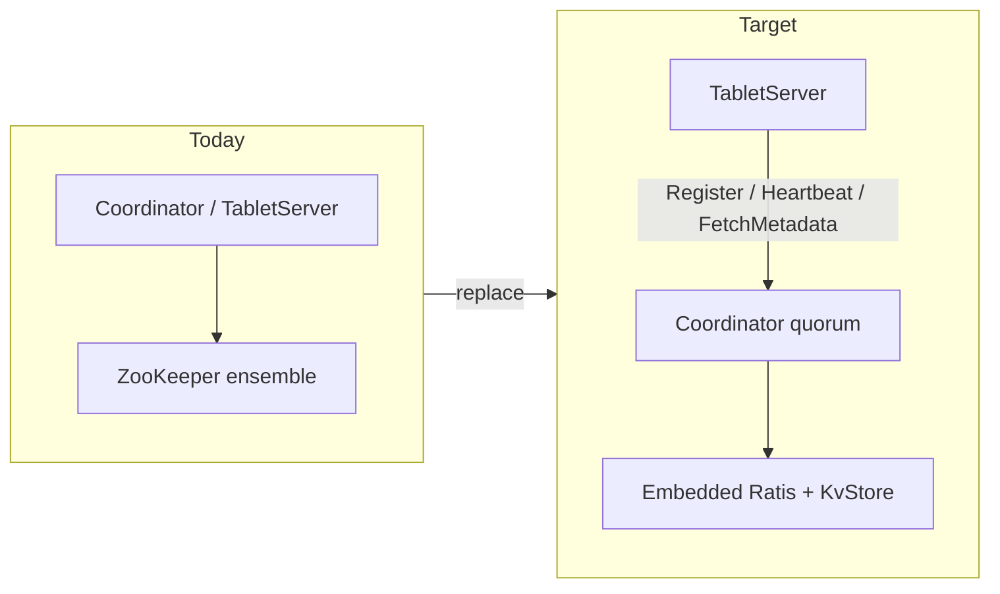

### 1.3 Expected Benefits

| Benefit | Description |
|---------|-------------|
| Simplified Deployment | Single Fluss cluster deployment without external ZK dependency |
| Reduced Operational Cost | No separate ZK maintenance, monitoring, or expertise required |
| Faster Startup | Eliminates ZK connection establishment time |
| Improved Reliability | Fewer moving parts, reduced cascade failure risk |
| Better Integration | Metadata and coordination tightly integrated with Fluss |

---

## 2. Motivation and Background

### 2.1 Current Pain Points

#### 2.1.1 Deployment Complexity

```yaml
# Current deployment requires ZK
services:
  zookeeper:
    image: zookeeper:3.9.2
    ports:
      - "2181:2181"
  
  coordinator:
    image: fluss:latest
    depends_on:
      - zookeeper
    configuration:
      zookeeper.address: zookeeper:2181
```

#### 2.1.2 Operational Overhead

- ZooKeeper ensemble must be properly configured (quorum size, tick time, etc.)
- Separate backup and disaster recovery procedures
- ZK version compatibility with Fluss shaded version
- Additional security configuration (SASL, ACLs)

#### 2.1.3 Roadmap Alignment

As stated in the [Fluss Architecture Documentation](https://fluss.apache.org/docs/concepts/architecture):

> "Fluss currently utilizes **ZooKeeper** for cluster coordination, metadata storage, and cluster configuration management. In upcoming releases, **ZooKeeper will be replaced** by **KvStore** for metadata storage and **Raft** for cluster coordination and ensuring consistency."

### 2.2 Use Cases for ZK Removal

1. **Simple Single-Node Deployment**: Developers want to run Fluss locally without ZK
2. **Containerized Environments**: Kubernetes deployments prefer self-contained applications
3. **Edge Deployments**: Resource-constrained environments cannot afford ZK overhead
4. **Cloud-Native Operations**: Users expect elastic scaling without ZK reconfiguration

---

## 3. Current Architecture Analysis

### 3.1 ZooKeeper Usage Overview

Fluss uses ZooKeeper for the following purposes:

```
┌─────────────────────────────────────────────────────────────────┐
│                        ZooKeeper Usage                          │
├─────────────────────────────────────────────────────────────────┤
│  1. Cluster Coordination                                        │
│     - Coordinator Leader Election                              │
│     - TabletServer Registration                                │
│     - Cluster Membership                                       │
│                                                                 │
│  2. Metadata Storage                                           │
│     - Database/Table/Partition Metadata                       │
│     - Schema Information                                       │
│     - Table/Partition Assignments                              │
│     - LeaderAndIsr Information                                 │
│                                                                 │
│  3. Sequence ID Generation                                     │
│     - Table ID Counter                                        │
│     - Partition ID Counter                                    │
│     - Writer ID Counter                                       │
│     - Snapshot ID Counter                                     │
│                                                                 │
│  4. Configuration Management                                   │
│     - Dynamic Config Changes                                  │
│     - Config Change Notifications                              │
│                                                                 │
│  5. Lease Management                                          │
│     - KV Snapshot Leases                                     │
│                                                                 │
│  6. Security (ACL)                                            │
│     - Access Control Lists                                    │
│     - ACL Change Notifications                                │
│                                                                 │
│  7. Producer State                                            │
│     - Producer Offset Snapshots                               │
│                                                                 │
│  8. Rebalance Coordination                                    │
│     - Rebalance Task Storage                                  │
└─────────────────────────────────────────────────────────────────┘
```

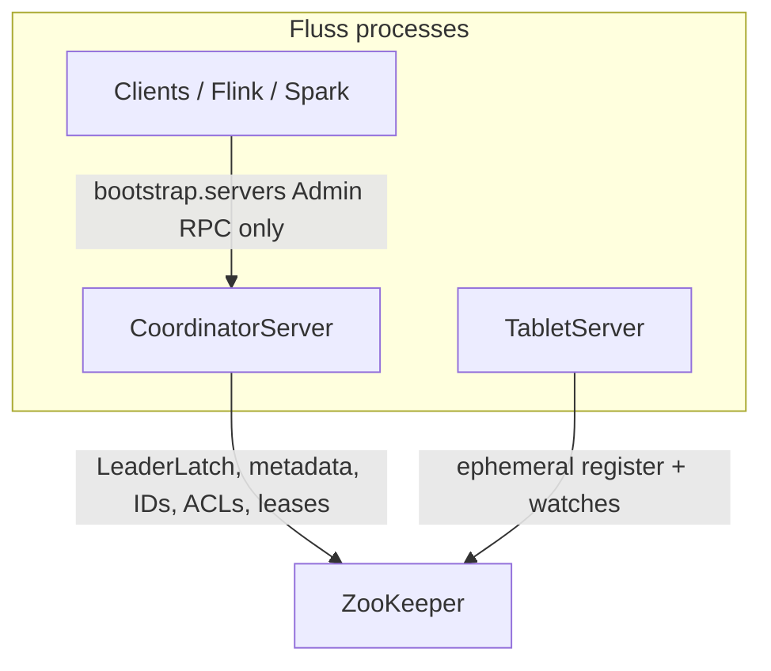

Clients never talk to ZooKeeper; only servers do. That is why flipping the metadata backend does not change `bootstrap.servers`.

### 3.2 ZooKeeper Data Model

The current ZK znode structure:

```
/
├── metadata/
│   ├── databases/
│   │   └── [databaseName]           # Database registration
│   ├── table_seqid                  # Sequence ID for tables
│   ├── partition_seqid              # Sequence ID for partitions
│   └── writer_id                    # Sequence ID for writers
│
├── coordinators/
│   ├── ids/
│   │   └── [serverId]              # Coordinator registration (ephemeral)
│   ├── election                     # Leader latch node
│   ├── active                       # Active coordinator node
│   └── epoch                        # Coordinator epoch for fencing
│
├── tabletservers/
│   ├── seqid                        # Sequence ID for server registration
│   ├── ids/
│   │   └── [serverId]              # TabletServer registration (ephemeral)
│   ├── tables/
│   │   └── [tableId]               # Table assignment
│   ├── partitions/
│   │   └── [partitionId]           # Partition assignment
│   ├── server_tags                  # Server tag information
│   └── [tableId|partitionId]/
│       └── buckets/
│           └── [bucketId]/
│               ├── leader_isr       # Leader and ISR information
│               ├── snapshots/       # Bucket snapshots
│               ├── snapshot_seqid   # Snapshot sequence ID
│               └── remote_logs      # Remote log manifest
│
├── config/
│   ├── server/
│   │   └── global                  # Global dynamic config
│   └── changes/                    # Config change notifications
│
├── fluss-acls/
│   └── [resourceType]/
│       └── [resourceName]          # ACL for resource
├── fluss-acl-changes/              # ACL change notifications
│
├── cluster/
│   └── rebalance                   # Rebalance task
│
├── producers/
│   └── [producerId]                # Producer offset snapshot
│
└── leases/
    └── kv_snapshot/                # KV snapshot leases
        └── [leaseId]
```

### 3.3 Key Components Using ZooKeeper

#### 3.3.1 ZooKeeperClient (`fluss-server/src/main/java/org/apache/fluss/server/zk/ZooKeeperClient.java`)

Main client class providing CRUD operations for all ZK znodes.

#### 3.3.2 CoordinatorLeaderElection (`CoordinatorLeaderElection.java`)

Uses Curator's `LeaderLatch` for coordinator leader election.

#### 3.3.3 ZkSequenceIDCounter (`ZkSequenceIDCounter.java`)

Uses Curator's `DistributedAtomicLong` for generating unique IDs.

#### 3.3.4 TabletServer Registration

TabletServers register themselves as ephemeral nodes under `/tabletservers/ids/`.

---

## 4. Target Architecture

### 4.1 High-Level Architecture

```
┌─────────────────────────────────────────────────────────────────────────────┐
│                         Target Architecture                                 │
├─────────────────────────────────────────────────────────────────────────────┤
│                                                                             │
│   ┌──────────────────┐              ┌──────────────────┐                    │
│   │ Coordinator      │              │ TabletServer     │                    │
│   │ Server (Leader)  │◄─────┐      │                  │                    │
│   └──────────────────┘      │      └──────────────────┘                    │
│           │                  │              │                               │
│           │                  │              │                               │
│   ┌───────▼────────────┐   │      ┌───────▼────────────┐                  │
│   │  Metadata Store     │   │      │  Local KvStore     │                  │
│   │  (Raft Replicated) │   │      │  (Replicated)      │                  │
│   └────────────────────┘   │      └────────────────────┘                  │
│           │                  │              │                               │
│           │                  │              │                               │
│   ┌───────▼────────────┐   │      ┌───────▼────────────┐                  │
│   │  Raft Consensus    │   └──────│  Raft Consensus    │                  │
│   │  Module            │◄─────────│  Module            │                  │
│   └────────────────────┘          └────────────────────┘                  │
│           │                                  │                             │
│           └──────────────────────────────────┘                             │
│                         Raft Communication                                  │
│                                                                             │
└─────────────────────────────────────────────────────────────────────────────┘
```

TabletServers are **not** Ratis peers (see 5.1.1). The diagram below is the implemented split: only Coordinators form the Raft group; TabletServers discover the leader via `coordinator.seed.nodes` and consume a pull-based metadata stream.

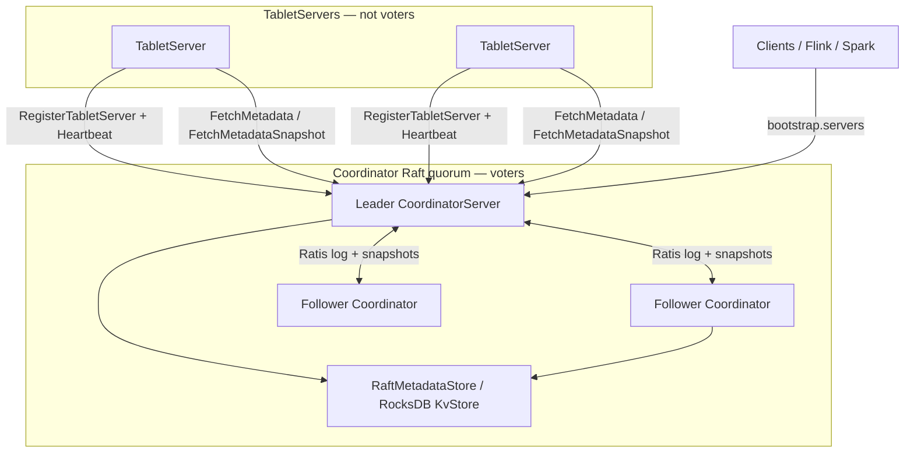

### 4.2 Component Breakdown

#### 4.2.1 Raft Module

Responsible for:
- Leader election among Coordinator Servers
- Log replication for metadata changes
- Cluster membership management
- Configuration changes (Raft cluster reconfiguration)

#### 4.2.2 Embedded Metadata Store

Responsible for:
- Storing all metadata previously in ZK
- Providing atomic operations for metadata updates
- Supporting watch/notification mechanism

#### 4.2.3 Sequence ID Service

Responsible for:
- Generating unique IDs for tables, partitions, writers
- Using Raft log for atomic ID generation

### 4.3 Data Flow Comparison

#### Current (With ZK)

```
Coordinator              ZooKeeper              TabletServer
    │                       │                       │
    │── Register ──────────►│                       │
    │                       │                       │
    │    Start Election     │                       │
    │──────────────────────►│                       │
    │◄──────────────────────│  Leader Latch         │
    │                       │                       │
    │                       │── Register (Ephemeral)│
    │                       │◄──────────────────────│
    │                       │                       │
    │◄── Get Assignments ──│                       │
    │                       │                       │
```

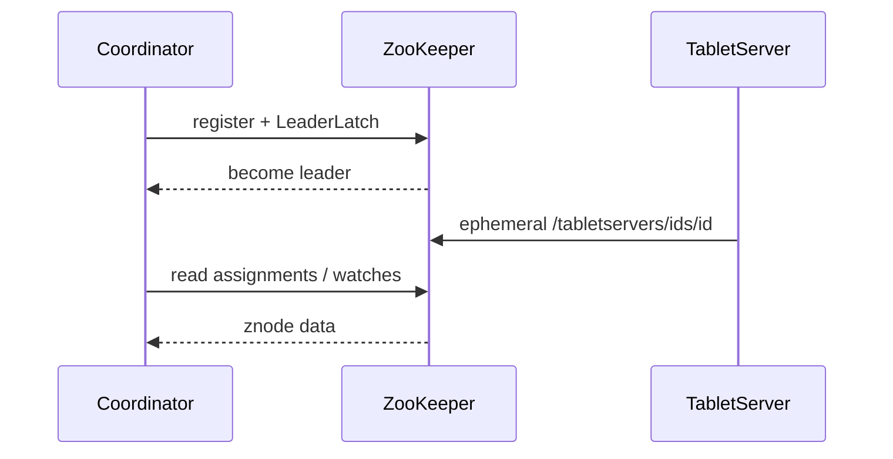

#### Target (Without ZK)

```
Coordinator (Leader)        Coordinator (Follower)     TabletServer
    │                            │                         │
    │── Raft Vote Request ─────►│                         │
    │◄── Raft Vote Response ────│                         │
    │                            │                         │
    │── TabletServer Register ────────────────────────────►│
    │◄── Register ACK ────────────────────────────────────│
    │                            │                         │
    │── Replicate Metadata ────►│                         │
    │◄── Replicate ACK ─────────│                         │
    │                            │                         │
```

Register is initiated by the **TabletServer** (the ASCII arrow above is schematic). Implemented flow:

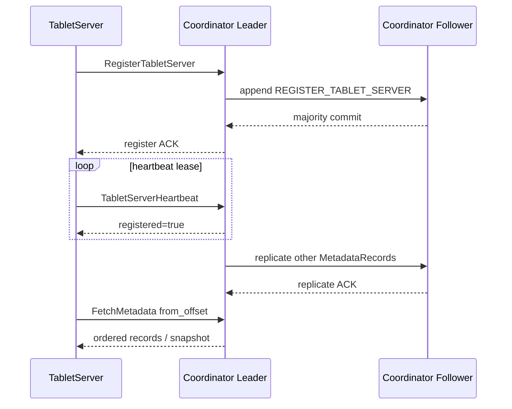

---

## 5. Detailed Design

> **Reference implementations.** This section derives concrete, code-line-level design from proven ZK-removal work:
>
> - **Apache Ratis** — embed a `RaftServer` inside each Coordinator and unify **leader election + log replication (journal)** into a single Raft group. This is the chosen engine because Fluss needs a *lightweight, embeddable* solution (see FAQ 11.4) and already serializes metadata as JSON, which maps 1:1 onto Ratis log records.
> - **AutoMQ / Kafka KRaft** (`/opt/sourcecode/automq`, modules `raft/` and `metadata/`) — provides the `RaftClient<T>` + `Listener` callback model, the `QuorumState`/`EpochState` state-machine pattern, record-based metadata (`MetadataImage`/`MetadataDelta`), and broker registration/heartbeat that replace ZK ephemeral nodes. We borrow these *patterns* (not the Kafka-coupled code).
>
> **Decision: adopt Apache Ratis as the Raft engine** rather than hand-writing Raft, and layer a KRaft-style record/apply model on top. Ratis is shaded under `org.apache.fluss.shaded.ratis.*` following the rules in Section 7.

### 5.1 Raft Consensus Implementation

#### 5.1.1 Raft Node Types

| Node Type | Ratis role | Description |
|-----------|-----------|-------------|
| **Coordinator (Voter)** | `RaftPeer` in the group's peer list | Full Raft participant; votes, replicates log, can become leader. |
| **TabletServer (Observer/Learner)** | Not a Ratis peer | Does not join the Raft group. Registers via RPC to the leader and consumes a *metadata stream* (KRaft-style `MetadataLoader`), analogous to a Kafka broker that is not a controller voter. |

Rationale: keeping TabletServers out of the Raft quorum (unlike making every node a voter) keeps the quorum small and stable during elastic scaling — the same split KRaft draws between *controllers* (voters) and *brokers* (observers).

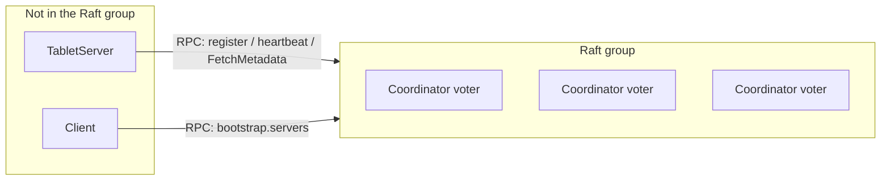

#### 5.1.2 Embedded Raft Server (Ratis)

The heart of the design is a `RaftMetadataServer` that embeds a Ratis `RaftServer`.

New file: `fluss-server/src/main/java/org/apache/fluss/server/coordinator/raft/RaftMetadataServer.java`

```java
package org.apache.fluss.server.coordinator.raft;

import org.apache.fluss.annotation.VisibleForTesting;
import org.apache.fluss.config.Configuration;
import org.apache.fluss.shaded.ratis.org.apache.ratis.protocol.RaftGroup;
import org.apache.fluss.shaded.ratis.org.apache.ratis.protocol.RaftGroupId;
import org.apache.fluss.shaded.ratis.org.apache.ratis.protocol.RaftPeer;
import org.apache.fluss.shaded.ratis.org.apache.ratis.protocol.RaftPeerId;
import org.apache.fluss.shaded.ratis.org.apache.ratis.server.RaftServer;
import org.apache.fluss.shaded.ratis.org.apache.ratis.server.RaftServerConfigKeys;

import javax.annotation.concurrent.ThreadSafe;

import java.io.IOException;
import java.util.UUID;

/**
 * Embeds an Apache Ratis {@link RaftServer} inside a CoordinatorServer, providing leader election
 * and replicated metadata log. Replaces the ZooKeeper ensemble entirely.
 *
 * <p>A single fixed Raft group holds the whole cluster metadata; leadership drives which
 * Coordinator is the active leader (see {@link RaftLeaderSelector}); committed entries are applied
 * by {@link FlussMetadataStateMachine}.
 */
@ThreadSafe
public class RaftMetadataServer implements AutoCloseable {

    // Fixed cluster-wide Raft group id. Deterministically derived from the configured cluster
    // id so multiple clusters cannot mix.
    public static final UUID DEFAULT_GROUP_UUID =
            UUID.fromString("f1u55c00-0000-0000-0000-000000000001");
    public static final RaftGroupId RAFT_GROUP_ID = RaftGroupId.valueOf(DEFAULT_GROUP_UUID);

    private final Configuration conf;
    private final RaftPeerId peerId;
    private final RaftGroup raftGroup;
    private final FlussMetadataStateMachine stateMachine;
    private RaftServer server;

    public RaftMetadataServer(
            Configuration conf,
            RaftPeerId peerId,
            RaftGroup raftGroup,
            FlussMetadataStateMachine stateMachine) {
        this.conf = conf;
        this.peerId = peerId;
        this.raftGroup = raftGroup;
        this.stateMachine = stateMachine;
    }

    /** Builds and starts the embedded Ratis server. */
    public synchronized void start() throws IOException {
        org.apache.fluss.shaded.ratis.org.apache.ratis.conf.RaftProperties properties =
                buildRaftProperties();
        this.server =
                RaftServer.newBuilder()
                        .setServerId(peerId)
                        .setGroup(raftGroup)
                        .setStateMachine(stateMachine)
                        .setProperties(properties)
                        .build();
        server.start();
    }

    /** Maps Fluss config options to Ratis timing knobs. */
    private org.apache.fluss.shaded.ratis.org.apache.ratis.conf.RaftProperties
            buildRaftProperties() {
        org.apache.fluss.shaded.ratis.org.apache.ratis.conf.RaftProperties p =
                new org.apache.fluss.shaded.ratis.org.apache.ratis.conf.RaftProperties();
        java.time.Duration election = conf.get(ConfigOptions.COORDINATOR_RAFT_ELECTION_TIMEOUT);
        java.time.Duration firstElection =
                conf.get(ConfigOptions.COORDINATOR_RAFT_FIRST_ELECTION_TIMEOUT);
        // Election timeouts (min/max) derived from the configured election timeout.
        RaftServerConfigKeys.Rpc.setTimeoutMin(p, toTimeDuration(election.dividedBy(2)));
        RaftServerConfigKeys.Rpc.setTimeoutMax(p, toTimeDuration(election));
        // Faster first election on a fresh single-node cluster.
        RaftServerConfigKeys.Rpc.setFirstElectionTimeoutMin(
                p, toTimeDuration(firstElection.dividedBy(2)));
        RaftServerConfigKeys.Rpc.setFirstElectionTimeoutMax(p, toTimeDuration(firstElection));
        RaftServerConfigKeys.Log.setSegmentSizeMax(
                p, sizeBytes(conf.get(ConfigOptions.COORDINATOR_RAFT_LOG_SEGMENT_SIZE)));
        RaftServerConfigKeys.Snapshot.setAutoTriggerEnabled(p, true);
        RaftServerConfigKeys.Snapshot.setAutoTriggerThreshold(
                p, conf.get(ConfigOptions.COORDINATOR_RAFT_SNAPSHOT_TRIGGER_THRESHOLD));
        RaftServerConfigKeys.setStorageDir(
                p,
                java.util.Collections.singletonList(
                        new File(conf.getString(ConfigOptions.COORDINATOR_RAFT_DIR))));
        return p;
    }

    @VisibleForTesting
    RaftServer getRaftServer() {
        return server;
    }

    @Override
    public synchronized void close() throws IOException {
        if (server != null) {
            server.close();
        }
    }
}
```

#### 5.1.3 Raft Log Record Model

Instead of the placeholder `RaftLogEntry` above, we adopt a **KRaft-style typed record model** carried inside a Ratis `Message`. Each committed record is deserialized and dispatched by the state machine. The wire format reuses Fluss's existing JSON serdes so no new proto is strictly required for v1.

New file: `fluss-server/src/main/java/org/apache/fluss/server/coordinator/raft/MetadataRecord.java`

```java
package org.apache.fluss.server.coordinator.raft;

import org.apache.fluss.annotation.Internal;

import javax.annotation.Nullable;

/**
 * A single replicated metadata mutation. Serialized into the Ratis log via {@link #toBytes()} and
 * re-applied deterministically on every Coordinator by {@link FlussMetadataStateMachine#applyEntry}.
 *
 * <p>Analogous to a KRaft {@code ApiMessageAndVersion} record (AutoMQ metadata/ module).
 * Immutable; carried inside a Ratis {@code Message}.
 */
@Internal
public final class MetadataRecord {

    /** Record type. One enum value per former ZK write path. */
    public enum Type {
        // --- metadata CRUD (former /metadata/** znodes) ---
        REGISTER_DATABASE,
        DELETE_DATABASE,
        REGISTER_TABLE,
        DELETE_TABLE,
        REGISTER_SCHEMA,
        REGISTER_PARTITION,
        DELETE_PARTITION,
        // --- assignments (former /tabletservers/{tables,partitions}/**) ---
        UPDATE_TABLE_ASSIGNMENT,
        UPDATE_PARTITION_ASSIGNMENT,
        // --- table state (former .../buckets/[id]/leader_isr) ---
        UPDATE_LEADER_AND_ISR,
        // --- server membership (former ephemeral /tabletservers/ids/**) ---
        REGISTER_TABLET_SERVER,
        FENCE_TABLET_SERVER,
        // NOTE: there is deliberately NO BUMP_COORDINATOR_EPOCH record. The former
        // /coordinators/epoch znode is subsumed by the Raft leader term (5.1.6): the term is not
        // application state and is never written to the metadata log — it comes from Ratis itself.
        // --- id generation (former DistributedAtomicLong counters) ---
        ALLOCATE_ID_RANGE,
        // --- dynamic config / acl / lease / producer ---
        UPDATE_DYNAMIC_CONFIG,
        UPDATE_ACL,
        UPDATE_KV_SNAPSHOT_LEASE,
        UPDATE_PRODUCER_SNAPSHOT
    }

    private final Type type;
    private final byte[] payload; // reuse existing *JsonSerde (e.g. TableRegistrationJsonSerde)
    @Nullable private final byte[] key; // logical key, e.g. tablePath / tableBucket bytes

    public MetadataRecord(Type type, @Nullable byte[] key, byte[] payload) {
        this.type = type;
        this.key = key;
        this.payload = payload;
    }

    public Type type() {
        return type;
    }

    @Nullable
    public byte[] key() {
        return key;
    }

    public byte[] payload() {
        return payload;
    }

    /** [1B version][2B type ordinal][4B keyLen][key][4B payloadLen][payload]. */
    public byte[] toBytes() {
        return MetadataRecordCodec.encode(this);
    }

    public static MetadataRecord fromBytes(byte[] bytes) {
        return MetadataRecordCodec.decode(bytes);
    }
}
```

**Record type → apply semantics → design section (no orphan types).** Every enum value's apply
behavior and payload schema is anchored to a section, so the enum and the rest of §5 stay in sync:

| Type | Apply semantics (`RaftMetadataStore.apply`) | Payload serde | Section |
|------|---------------------------------------------|---------------|---------|
| `REGISTER_/DELETE_DATABASE` | put/delete database key | `DatabaseRegistrationJsonSerde` | §5.2.1-5.2.2 |
| `REGISTER_/DELETE_TABLE` | put/delete table key | `TableRegistrationJsonSerde` | §5.2.2-5.2.3 |
| `REGISTER_SCHEMA` | put schema key | `SchemaJsonSerde` | §5.2.1 |
| `REGISTER_/DELETE_PARTITION` | put/delete partition key | `PartitionJsonSerde` | §5.2.1 |
| `UPDATE_TABLE_ASSIGNMENT` / `UPDATE_PARTITION_ASSIGNMENT` | put assignment key | `*AssignmentJsonSerde` | §5.2.1 |
| `UPDATE_LEADER_AND_ISR` | put leader_isr key | `LeaderAndIsrJsonSerde` | §5.2.1 |
| `REGISTER_TABLET_SERVER` / `FENCE_TABLET_SERVER` | add/remove server membership key | `TabletServerRegistrationJsonSerde` | **§5.4.2** |
| `ALLOCATE_ID_RANGE` | advance persisted id high-water mark (forward-only) | 8-byte long | **§5.3.2 / §5.3.3** |
| `UPDATE_DYNAMIC_CONFIG` | put global config key | config JSON | §5.2.1 |
| `UPDATE_ACL` | put/delete ACL key | ACL JSON | §5.2.1, §5.8.3 |
| `UPDATE_KV_SNAPSHOT_LEASE` | put/expire lease key (former `/leases/kv_snapshot/**`) | lease JSON | §5.2.1 |
| `UPDATE_PRODUCER_SNAPSHOT` | put producer-offset key (former `/producers/**`) | producer JSON | §5.2.1 |

All non-delete/non-fence types are ordinary key puts (deterministic `KvStore.put(key, payload)` +
`fireWatch`); only DELETE/FENCE remove keys. `ALLOCATE_ID_RANGE` is the one with non-trivial
producer-side logic — it is fully specified in §5.3.2 (block reservation) and §5.3.3 (per-counter
no-reuse), which is the explicit link between this enum and the id-generation design.

#### 5.1.4 State Machine (apply loop)

The state machine is the deterministic apply target for committed records.

> **Design decision (v2.0): pure commit-apply, NO pre-apply.** We **deliberately reject** applying on the leader before commit for v1 because it is the single largest correctness risk: if the leader mutates memory and the subsequent append fails (leader lost leadership / term changed mid-flight), the in-memory store is dirtied but the log has no such entry — a **permanent state/log divergence**. Recovering from that requires a full catch-up + memory-rebuild on `losePrimacy`, which is complex and easy to get wrong. Instead we adopt the **KRaft model** (Appendix 11.3: KRaft "applies on commit only"): *every* node — leader included — mutates `RaftMetadataStore` **only** inside `applyTransaction`, after the entry is committed. Pre-apply is a pure latency optimization (saves a few ms) that may be revisited post-GA behind a flag once the base model is proven.

New file: `fluss-server/src/main/java/org/apache/fluss/server/coordinator/raft/FlussMetadataStateMachine.java`

```java
package org.apache.fluss.server.coordinator.raft;

import org.apache.fluss.shaded.ratis.org.apache.ratis.proto.RaftProtos.LogEntryProto;
import org.apache.fluss.shaded.ratis.org.apache.ratis.protocol.Message;
import org.apache.fluss.shaded.ratis.org.apache.ratis.protocol.RaftGroupMemberId;
import org.apache.fluss.shaded.ratis.org.apache.ratis.protocol.RaftPeerId;
import org.apache.fluss.shaded.ratis.org.apache.ratis.statemachine.TransactionContext;
import org.apache.fluss.shaded.ratis.org.apache.ratis.statemachine.impl.BaseStateMachine;

import javax.annotation.concurrent.GuardedBy;

import java.util.Collection;
import java.util.concurrent.CompletableFuture;

/**
 * Deterministic apply target for the replicated metadata log. Follows the KRaft commit-apply model:
 * state is mutated ONLY here, after Ratis commits an entry, on EVERY node including the leader. This
 * makes the in-memory store a pure function of the committed log — no pre-apply, no divergence risk.
 *
 * <p>Apply is single-threaded (Ratis serializes applyTransaction). See Section 5.6 (Thread Model)
 * for the strict rule that no apply-thread code may synchronously wait on a new append.
 */
public class FlussMetadataStateMachine extends BaseStateMachine {

    private static final CompletableFuture<Message> EMPTY =
            CompletableFuture.completedFuture(Message.EMPTY);

    private final RaftMetadataStore store; // KvStore-backed, Section 5.2
    private final RaftLeaderSelector leaderSelector; // Section 5.1.5

    @GuardedBy("this")
    private long lastAppliedIndex = -1;

    // Futures awaiting a given applied index (used by RaftJournalWriter.append to know when the
    // committed entry has become locally visible). Keyed by target index.
    @GuardedBy("this")
    private final java.util.NavigableMap<Long, CompletableFuture<Long>> appliedWaiters =
            new java.util.TreeMap<>();

    public FlussMetadataStateMachine(RaftMetadataStore store, RaftLeaderSelector leaderSelector) {
        this.store = store;
        this.leaderSelector = leaderSelector;
    }

    /** Cf. KRaft RaftClient.Listener#handleCommit. */
    @Override
    public CompletableFuture<Message> applyTransaction(TransactionContext trx) {
        try {
            LogEntryProto entry = trx.getLogEntry();
            byte[] data = trx.getStateMachineLogEntry().getLogData().toByteArray();
            applyEntry(MetadataRecord.fromBytes(data), entry.getIndex());
            updateLastAppliedTermIndex(entry.getTerm(), entry.getIndex());
            return EMPTY;
        } catch (Exception e) {
            CompletableFuture<Message> f = new CompletableFuture<>();
            f.completeExceptionally(e);
            return f;
        }
    }

    /** Serialized by Ratis; the ONLY mutation path for the store on all nodes. */
    private synchronized void applyEntry(MetadataRecord record, long index) {
        if (index <= lastAppliedIndex) {
            return; // duplicate (retried write)
        }
        store.apply(record); // deterministic mutation of KvStore + fire local watches
        lastAppliedIndex = index;
        // Complete any waiter whose target index has now been applied.
        java.util.NavigableMap<Long, CompletableFuture<Long>> done =
                appliedWaiters.headMap(index, true);
        for (CompletableFuture<Long> w : done.values()) {
            w.complete(index);
        }
        done.clear();
    }

    public synchronized long lastAppliedIndex() {
        return lastAppliedIndex;
    }

    /**
     * Returns a future completing when {@code index} has been applied locally. Called from
     * RaftJournalWriter.append (NOT from the apply thread). Completes immediately if already applied.
     */
    public synchronized CompletableFuture<Long> awaitApplied(long index) {
        if (lastAppliedIndex >= index) {
            return CompletableFuture.completedFuture(lastAppliedIndex);
        }
        return appliedWaiters.computeIfAbsent(index, k -> new CompletableFuture<>());
    }

    /** Leadership callbacks. */
    @Override
    public void notifyLeaderChanged(RaftGroupMemberId groupMemberId, RaftPeerId leaderId) {
        boolean isLeader = groupMemberId.getPeerId().equals(leaderId);
        leaderSelector.notifyLeadershipChanged(isLeader);
    }

    @Override
    public void notifyNotLeader(Collection<TransactionContext> pendingEntries) {
        leaderSelector.notifyLeadershipChanged(false);
    }
}
```

#### 5.1.5 Leader Selection (replaces `CoordinatorLeaderElection`)

The existing `CoordinatorLeaderElection` (`fluss-server/.../coordinator/CoordinatorLeaderElection.java`) uses Curator `LeaderLatch` + `LeaderLatchListener`. It is replaced by a Raft-leadership-driven selector.

**Unified interface.** To keep `CoordinatorServer` backend-agnostic, both selectors implement a common
`LeaderElection` interface. This is what `MetadataStoreClient.newLeaderSelector()` (5.5.1) returns and
what `CoordinatorServer` holds — so the `leaderSelector.currentEpoch()` / `startElectLeaderAsync()`
calls in 7.3.1 type-check regardless of backend.

New file: `fluss-server/src/main/java/org/apache/fluss/server/coordinator/LeaderElection.java`

```java
package org.apache.fluss.server.coordinator;

import java.util.function.Consumer;

/**
 * Backend-neutral coordinator leader election. Implemented by {@code CoordinatorLeaderElection} (ZK,
 * Curator LeaderLatch) and {@code RaftLeaderSelector} (Ratis leadership). Same lifecycle as the
 * existing ZK class so CoordinatorServer needs no behavioral change.
 */
public interface LeaderElection extends AutoCloseable {

    void startElectLeaderAsync(Runnable initLeaderServices, Consumer<Throwable> cleanupLeaderServices);

    boolean isLeader();

    /**
     * The current coordinator epoch (fencing token). ZK impl returns the Zk-version-backed epoch
     * (see {@code ZkEpoch}); Raft impl returns the Raft-term-backed epoch (see {@code RaftEpoch},
     * 5.1.6). Both expose {@code coordinatorEpoch()} consumed by {@code CoordinatorContext}.
     */
    CoordinatorEpoch currentEpoch();

    @Override
    void close();
}
```

`CoordinatorEpoch` is a small interface (`int coordinatorEpoch()`) that both `ZkEpoch` and `RaftEpoch`
implement, so `CoordinatorContext` (which today takes a `ZkEpoch`) accepts either without change.

New file: `fluss-server/src/main/java/org/apache/fluss/server/coordinator/raft/RaftLeaderSelector.java`

```java
package org.apache.fluss.server.coordinator.raft;

import org.apache.fluss.exception.CoordinatorEpochFencedException;
import org.apache.fluss.server.coordinator.LeaderElection;

import org.slf4j.Logger;
import org.slf4j.LoggerFactory;

import java.util.concurrent.CompletableFuture;
import java.util.concurrent.ExecutorService;
import java.util.concurrent.Executors;
import java.util.concurrent.TimeUnit;
import java.util.concurrent.atomic.AtomicBoolean;
import java.util.concurrent.atomic.AtomicReference;
import java.util.function.Consumer;

/**
 * Raft-leadership-backed {@link LeaderElection}, replacing the Curator-LeaderLatch-based
 * {@code CoordinatorLeaderElection}. Public surface (startElectLeaderAsync/isLeader/currentEpoch/
 * close) is the LeaderElection contract, so the CoordinatorServer integration is a single swap.
 *
 * <p>On gaining leadership we first wait for the state machine to catch up to the leader's
 * committed index, then run initLeaderServices; on losing it we run cleanupLeaderServices. The
 * pending-cleanup-before-init ordering from the original class is kept. NOTE: with the pure
 * commit-apply model (5.1.4) there is no ignore-applys toggle — the store is always a function of
 * the committed log.
 */
public class RaftLeaderSelector implements LeaderElection {

    private static final Logger LOG = LoggerFactory.getLogger(RaftLeaderSelector.class);

    private final String serverId;
    private final RaftMetadataServer raftServer;
    private final FlussMetadataStateMachine stateMachine;
    private final long catchUpTimeoutMs; // COORDINATOR_RAFT_CATCHUP_TIMEOUT (Appendix 11.2)
    private final AtomicBoolean isLeader = new AtomicBoolean(false);
    private final ExecutorService callbackExecutor;
    private final AtomicReference<CompletableFuture<Void>> pendingCleanup =
            new AtomicReference<>(CompletableFuture.completedFuture(null));

    private volatile Runnable initLeaderServices;
    private volatile Consumer<Throwable> cleanupLeaderServices;

    public RaftLeaderSelector(
            String serverId,
            RaftMetadataServer raftServer,
            FlussMetadataStateMachine stateMachine,
            long catchUpTimeoutMs) {
        this.serverId = serverId;
        this.raftServer = raftServer;
        this.stateMachine = stateMachine;
        this.catchUpTimeoutMs = catchUpTimeoutMs;
        this.callbackExecutor =
                Executors.newCachedThreadPool(
                        r -> {
                            Thread t = new Thread(r, "coordinator-leader-callback-" + serverId);
                            t.setDaemon(true);
                            return t;
                        });
    }

    /** Same signature as CoordinatorLeaderElection.startElectLeaderAsync(...):94. */
    @Override
    public void startElectLeaderAsync(
            Runnable initLeaderServices, Consumer<Throwable> cleanupLeaderServices) {
        this.initLeaderServices = initLeaderServices;
        this.cleanupLeaderServices = cleanupLeaderServices;
        // No explicit start(): the embedded Ratis server elects automatically; leadership arrives
        // via FlussMetadataStateMachine.notifyLeaderChanged -> notifyLeadershipChanged below.
    }

    /** Invoked by the state machine on every Raft role change. gainPrimacy/losePrimacy. */
    void notifyLeadershipChanged(boolean nowLeader) {
        if (nowLeader) {
            gainPrimacy();
        } else {
            losePrimacy();
        }
    }

    private void gainPrimacy() {
        if (isLeader.get()) {
            return;
        }
        CompletableFuture<Void> cleanup = pendingCleanup.get();
        callbackExecutor.execute(
                () -> {
                    try {
                        cleanup.get(); // wait for prior cleanup (cf. original :107-125)
                        // Wait until this node's applied index reaches the leader's commit index so
                        // reads/writes see a complete view before we start serving as leader.
                        awaitCatchUp();
                        initLeaderServices.run();
                        isLeader.set(true);
                    } catch (CoordinatorEpochFencedException e) {
                        LOG.warn("Coordinator {} fenced, stepping down.", serverId);
                        losePrimacy();
                    } catch (Exception e) {
                        LOG.error("initLeaderServices failed for {}", serverId, e);
                        losePrimacy();
                    }
                });
    }

    /**
     * Blocks until this node has applied every entry that was already committed at the moment it
     * gained leadership, i.e. lastAppliedIndex >= commitIndexAtLeadershipGain. This is mandatory
     * under the pure commit-apply model (5.1.4): a freshly-elected leader may still be replaying a
     * backlog of committed-but-not-yet-applied entries, and leader-only reads (5.7) must not observe
     * a half-applied store. Termination condition and source of truth:
     *
     *   RaftServer.Division div = raftServer.getRaftServer().getDivision(RAFT_GROUP_ID);
     *   long commitIndex = div.getInfo().getCommitIndex();   // committed at leadership gain
     *   // Raft guarantees a leader's commit index only advances within its term, and all entries
     *   // up to commitIndex are durable on a majority, so waiting for local apply is sufficient.
     *   stateMachine.awaitApplied(commitIndex).get(catchUpTimeoutMs, MILLISECONDS);
     *
     * awaitApplied(index) is the same future primitive defined on the state machine in 5.1.4.
     * Configuration / metadata Raft log entries never enter applyTransaction; notifyTermIndexUpdated
     * must complete the same waiters, otherwise catch-up hangs at a post-election commit index until
     * coordinator.raft.catchup.timeout and the node never becomes a serving Fluss leader. On timeout
     * this throws, so gainPrimacy falls back to losePrimacy and the node retries on the next
     * leadership signal rather than serving stale reads.
     */
    private void awaitCatchUp() throws Exception {
        long commitIndex =
                raftServer
                        .getRaftServer()
                        .getDivision(RaftMetadataServer.RAFT_GROUP_ID)
                        .getInfo()
                        .getCommitIndex();
        stateMachine.awaitApplied(commitIndex).get(catchUpTimeoutMs, TimeUnit.MILLISECONDS);
    }

    /** Raft-term-backed coordinator epoch (see RaftEpoch, 5.1.6). Fencing token for the leader. */
    @Override
    public RaftEpoch currentEpoch() {
        long term =
                raftServer
                        .getRaftServer()
                        .getDivision(RaftMetadataServer.RAFT_GROUP_ID)
                        .getInfo()
                        .getCurrentTerm();
        return new RaftEpoch(term);
    }

    private void losePrimacy() {
        if (isLeader.compareAndSet(true, false)) {
            CompletableFuture<Void> f = new CompletableFuture<>();
            pendingCleanup.set(f);
            callbackExecutor.execute(
                    () -> {
                        try {
                            if (cleanupLeaderServices != null) {
                                cleanupLeaderServices.accept(null);
                            }
                        } finally {
                            f.complete(null);
                        }
                    });
        }
    }

    @Override
    public boolean isLeader() {
        return isLeader.get();
    }

    @Override
    public void close() {
        callbackExecutor.shutdownNow();
    }
}
```

#### 5.1.6 Coordinator Epoch / Fencing

ZK fencing today lives in `ZooKeeperClient.fenceBecomeCoordinatorLeader()` (bumps `/coordinators/epoch` with a `withVersion` compare-and-set; on `BadVersionException` throws `CoordinatorEpochFencedException`) and `ZkEpoch` (`ZkEpoch.java:38 nextZkEpoch()`).

With Raft, **the Raft term subsumes ZK's epoch/version fencing**: only one leader per term can commit, so split-brain is structurally impossible (cf. AutoMQ `QuorumState.transitionToLeader(epochStartOffset)` at `QuorumState.java:550` and KRaft's leader-epoch fencing). Both `ZkEpoch` and `RaftEpoch` implement the shared `CoordinatorEpoch` interface (5.1.5) so `CoordinatorContext` accepts either. We map:

```java
// New: fluss-server/.../coordinator/CoordinatorEpoch.java  (shared by ZkEpoch and RaftEpoch)
public interface CoordinatorEpoch {
    int coordinatorEpoch();
}

// New: fluss-server/.../coordinator/raft/RaftEpoch.java
// coordinatorEpoch <- Raft leader term (division.getInfo().getCurrentTerm()).
// The old (epoch, zkVersion) tuple in ZkEpoch collapses to a single monotonic term.
public final class RaftEpoch implements CoordinatorEpoch {
    private final long raftTerm;

    public RaftEpoch(long raftTerm) {
        this.raftTerm = raftTerm;
    }

    @Override
    public int coordinatorEpoch() {
        return Math.toIntExact(raftTerm);
    }
}
```

`initCoordinatorLeader()` in `CoordinatorServer.java:306-308` changes from
`ZkEpoch e = zkClient.fenceBecomeCoordinatorLeader(serverId)` to `leaderSelector.currentEpoch()`
(which reads the current Raft term, 5.1.5), guaranteed unique per leader. A stale leader that regained CPU after a pause will fail its next `scheduleAtomicAppend` because Ratis rejects appends from a non-current term — the same fencing guarantee, now free.

### 5.2 Metadata Store Design

#### 5.2.1 Key mapping: former ZK znodes → KvStore keys

The current znode paths are defined in `ZkData.java` (see the 40+ `*ZNode` inner classes, e.g. `DatabaseZNode.path()`, `TableZNode.path()`, `LeaderAndIsrZNode.path()`, `CoordinatorEpochZNode.path()`). Each `path()` maps 1:1 to a KvStore key using a **uniform fixed 3-byte header** `[1B namespace][2B type]` followed by a length-prefixed body. The header is identical in structure for every entity so `MetadataKeys.keyOf()` / `decode()` are fully generic: read namespace, read type, then dispatch. This keeps the *logical* layout identical to ZK, so the migration tool (Section 6.3) is a mechanical path-rewrite.

```
Uniform key layout (big-endian, lexicographically orderable for prefix scans):
┌───────────┬──────────┬────────────────────────────┐
│ Namespace │ Type     │ Body (variable)             │
│ (1 byte)  │ (2 bytes)│ length-prefixed components  │
└───────────┴──────────┴────────────────────────────┘
   ^ top-level category   ^ entity/resource discriminator WITHIN the namespace

Rule: the 2-byte "type" is ALWAYS a discriminator whose meaning is scoped to the namespace
(entity type for metadata, resource type for ACL, counter kind for ids, ...). Never a raw id.
Ids/names always live in the length-prefixed body, never in the header.

Zk path (ZkData)                              ->  namespace | type   | body
/fluss/metadata/databases/[db]                ->  0x01      | 0x0001 | <db>
/fluss/metadata/.../tables/[t]                ->  0x01      | 0x0002 | <db><t>        (TableZNode)
/fluss/metadata/.../schemas/[id]              ->  0x01      | 0x0003 | <db><t><id>    (SchemaZNode)
/fluss/tabletservers/tables/[tableId]         ->  0x02      | 0x0001 | <tableId:8B>   (TableAssignment)
/fluss/.../buckets/[b]/leader_isr             ->  0x03      | 0x0001 | <tableId:8B><b:4B>
/fluss/config/server/global                   ->  0x04      | 0x0001 | (empty)        (dynamic config)
/fluss/fluss-acls/[resType]/[name]            ->  0x05      | <resType:2B> | <name>   (ACL)
/fluss/leases/kv_snapshot/[id]                ->  0x06      | 0x0001 | <id:8B>        (KV lease)
/fluss/producers/[producerId]                 ->  0x07      | 0x0001 | <producerId:8B>(producer)
/fluss/.../{table|partition|writer}_seqid     ->  0x08      | 0x000{1|2|3} | (empty)  (id high-water)
```

Note the ACL row: `resType` occupies the same 2-byte `type` slot as other entities' type constant —
it is *still* a within-namespace discriminator, so the header stays uniform (`MetadataKeys` does not
special-case it structurally, only semantically after reading the namespace).

#### 5.2.2 `RaftMetadataStore` — apply target + read view

The store is the deterministic mutation target invoked by `FlussMetadataStateMachine.applyEntry()` and the read view used by `MetadataManager`, `ServerMetadataCache`, `CoordinatorContext`, etc. It wraps a `KvStore` (Fluss already ships RocksDB-backed `KvStore` in `fluss-server/.../kv/`).

New file: `fluss-server/src/main/java/org/apache/fluss/server/coordinator/raft/RaftMetadataStore.java`

```java
package org.apache.fluss.server.coordinator.raft;

import org.apache.fluss.annotation.Internal;

/**
 * KvStore-backed metadata store. {@link #apply(MetadataRecord)} is the ONLY write path and is called
 * from the single-threaded state-machine apply loop, so no external locking is needed for writes
 * (Ratis serializes {@code applyTransaction}). Reads are lock-free snapshots.
 */
@Internal
public class RaftMetadataStore {

    private final org.apache.fluss.server.kv.KvStore kvStore;
    private final MetadataWatchService watchService;

    public RaftMetadataStore(
            org.apache.fluss.server.kv.KvStore kvStore, MetadataWatchService watchService) {
        this.kvStore = kvStore;
        this.watchService = watchService;
    }

    /** Deterministic mutation. Dispatch is a plain switch over record type. */
    public void apply(MetadataRecord record) {
        byte[] key = MetadataKeys.keyOf(record); // maps type+logicalKey -> KvStore key (5.2.1)
        byte[] oldValue;
        switch (record.type()) {
            // Removal types: delete the key. (FENCE_TABLET_SERVER removes a membership key.)
            case DELETE_DATABASE:
            case DELETE_TABLE:
            case DELETE_PARTITION:
            case FENCE_TABLET_SERVER:
                oldValue = kvStore.get(key);
                kvStore.delete(key);
                watchService.fireWatch(key, oldValue, null);
                break;
            // All other types (REGISTER_*, UPDATE_*, ALLOCATE_ID_RANGE) are plain key puts and are
            // handled uniformly here — see the record-type table in 5.1.3 for the full mapping.
            default:
                oldValue = kvStore.get(key);
                kvStore.put(key, record.payload());
                watchService.fireWatch(key, oldValue, record.payload());
                break;
        }
    }

    // ---- read view (used by MetadataManager / ServerMetadataCache) ----
    public byte[] get(byte[] key) {
        return kvStore.get(key);
    }

    public java.util.List<byte[]> scanPrefix(byte[] prefix) {
        return kvStore.scan(prefix);
    }
}
```

#### 5.2.3 Write path: `MetadataManager` on top of Raft

Today `MetadataManager` and `ZooKeeperClient` write directly to ZK. The write path becomes: **(1) leader appends a `MetadataRecord` via Ratis, (2) the entry is committed by majority, (3) the state machine applies it locally (5.1.4) and only then the `append` future completes** — the pure KRaft commit-apply pattern (`QuorumController.appendWriteEvent` → `RaftClient.scheduleAtomicAppend` → `handleCommit`). There is **no pre-apply**: the store is mutated solely from the apply loop on every node, so a subsequent leader read observes the write because the future resolves after local apply.

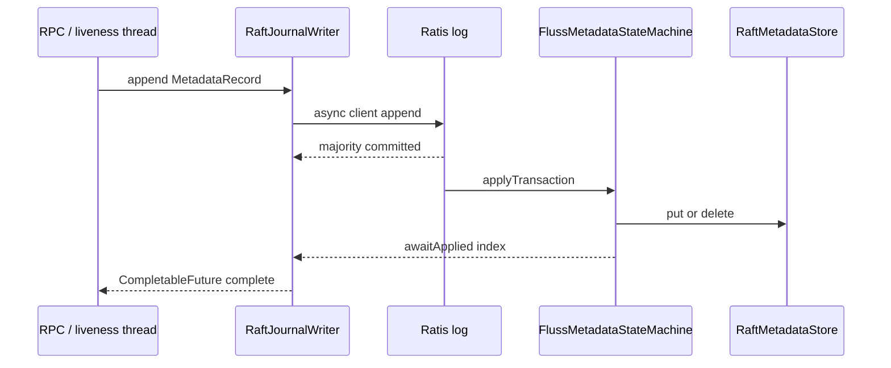

The apply thread must never call `writer.append()` or `.get()` on an append future (self-deadlock; §5.6).

New file: `fluss-server/src/main/java/org/apache/fluss/server/coordinator/raft/RaftJournalWriter.java`

```java
package org.apache.fluss.server.coordinator.raft;

import org.apache.fluss.shaded.ratis.org.apache.ratis.client.RaftClient;
import org.apache.fluss.shaded.ratis.org.apache.ratis.protocol.Message;
import org.apache.fluss.shaded.ratis.org.apache.ratis.protocol.RaftClientReply;
import org.apache.fluss.shaded.ratis.org.apache.ratis.thirdparty.com.google.protobuf.ByteString;

import java.util.concurrent.CompletableFuture;

/**
 * Leader-side writer that appends metadata records to the Raft log and completes when the entry is
 * committed AND applied to the local store. Cf. KRaft scheduleAtomicAppend.
 *
 * <p><b>Thread rule (Section 5.6):</b> append is ASYNC — it returns a {@link CompletableFuture} and
 * never blocks the calling thread. It MUST NOT be called from the single-threaded apply loop (doing
 * so would self-deadlock, because the future only completes once apply advances). RPC handlers,
 * timers ({@link TabletServerLivenessManager}), and id allocation all call this from their own
 * threads and compose on the returned future.
 */
public class RaftJournalWriter implements AutoCloseable {

    private final RaftClient raftClient; // built against the local group (RaftMetadataServer group)
    private final FlussMetadataStateMachine stateMachine;

    public RaftJournalWriter(RaftClient raftClient, FlussMetadataStateMachine stateMachine) {
        this.raftClient = raftClient;
        this.stateMachine = stateMachine;
    }

    /**
     * Asynchronously append and wait for majority commit. The returned future completes with the
     * committed log index once the local state machine has applied it (so a subsequent local read on
     * the leader observes the write — see 5.7 read consistency). Fails with NotLeaderException /
     * LeaderSteppingDownException if this node is no longer leader (fencing).
     */
    public CompletableFuture<Long> append(MetadataRecord record) {
        Message msg = Message.valueOf(ByteString.copyFrom(record.toBytes()));
        return raftClient
                .async()
                .send(msg)
                .thenCompose(
                        (RaftClientReply reply) -> {
                            if (!reply.isSuccess()) {
                                CompletableFuture<Long> f = new CompletableFuture<>();
                                f.completeExceptionally(reply.getException());
                                return f;
                            }
                            // wait until our own committed index has been applied locally
                            return stateMachine.awaitApplied(reply.getLogIndex());
                        });
    }

    @Override
    public void close() throws Exception {
        raftClient.close();
    }
}
```

The leader-side flow inside `MetadataManager.createTable(...)` becomes (pseudo-diff). Note there is
**no local pre-apply** — the state machine applies the committed entry on all nodes (5.1.4), and the
`append` future only resolves *after* that apply, so the value is visible to a subsequent leader read:

```java
// BEFORE (ZK): zkClient.registerTable(tablePath, registration);
// AFTER (Raft):
byte[] payload = TableRegistrationJsonSerde.INSTANCE.serialize(registration); // reuse existing serde
MetadataRecord rec =
        new MetadataRecord(MetadataRecord.Type.REGISTER_TABLE, tablePath.toBytes(), payload);
raftJournalWriter.append(rec).get(); // append -> commit -> applied-on-leader; NO separate apply call
```

For callers that are already async (RPC handlers), prefer chaining on the future
(`append(rec).thenAccept(...)`) rather than `.get()`, per the thread model (5.6).

#### 5.2.4 Watch / Notification (replaces ZK watchers)

ZK watchers today (`NodeChangeNotification`, `TableChangeWatcher`, `ServerChangeWatcher`, ACL change watchers) fire on znode changes. ZK's watch semantics have **two scopes** that must both be replaced:

1. **In-process (same JVM as the leader)** — e.g. the coordinator event processor reacting to its own metadata writes. This is handled by the `MetadataWatchService` below: fired locally from the apply loop.
2. **Cross-process (other JVMs: TabletServers, standby Coordinators, clients)** — e.g. a TabletServer learning its bucket became leader. **This is NOT solved by the in-process map** and is the harder half of "replace ZK watch". It is specified separately in **Section 5.8 (TabletServer Metadata Subscription)** as an explicit streaming RPC — it cannot be a `ConcurrentHashMap` callback.

The `MetadataWatchService` below therefore covers scope (1) only. Its `fireWatch` is also the hook that enqueues change events into the cross-process stream of 5.8.

New file: `fluss-server/src/main/java/org/apache/fluss/server/coordinator/raft/MetadataWatchService.java`

```java
package org.apache.fluss.server.coordinator.raft;

import java.util.concurrent.ConcurrentHashMap;
import java.util.concurrent.CopyOnWriteArrayList;

/** In-process watch dispatch. Fired from the (single-threaded) apply loop after each mutation. */
public class MetadataWatchService {

    @FunctionalInterface
    public interface WatchCallback {
        void onChange(byte[] key, byte[] oldValue, byte[] newValue);
    }

    // prefix (as hex string) -> callbacks
    private final ConcurrentHashMap<String, CopyOnWriteArrayList<WatchCallback>> watches =
            new ConcurrentHashMap<>();

    public void registerWatch(byte[] keyPrefix, WatchCallback cb) {
        watches.computeIfAbsent(hex(keyPrefix), k -> new CopyOnWriteArrayList<>()).add(cb);
    }

    public void unregisterWatch(byte[] keyPrefix, WatchCallback cb) {
        CopyOnWriteArrayList<WatchCallback> list = watches.get(hex(keyPrefix));
        if (list != null) {
            list.remove(cb);
        }
    }

    /** Called by RaftMetadataStore.apply() after the KvStore mutation is durable. */
    public void fireWatch(byte[] key, byte[] oldValue, byte[] newValue) {
        String h = hex(key);
        for (java.util.Map.Entry<String, CopyOnWriteArrayList<WatchCallback>> e :
                watches.entrySet()) {
            if (h.startsWith(e.getKey())) {
                for (WatchCallback cb : e.getValue()) {
                    cb.onChange(key, oldValue, newValue);
                }
            }
        }
    }

    private static String hex(byte[] b) {
        StringBuilder sb = new StringBuilder(b.length * 2);
        for (byte x : b) {
            sb.append(Character.forDigit((x >> 4) & 0xF, 16));
            sb.append(Character.forDigit(x & 0xF, 16));
        }
        return sb.toString();
    }
}
```

#### 5.2.5 Snapshots

Ratis auto-snapshots when the log grows past `RAFT_SNAPSHOT_TRIGGER_THRESHOLD` (see 5.1.2 `setAutoTriggerThreshold`). The state machine overrides `takeSnapshot()`/`loadSnapshot()` to serialize/restore the KvStore. Because the KvStore is RocksDB-backed, a snapshot is a RocksDB checkpoint (hard-link, near-instant) rather than a full dump.

**Snapshot ↔ metadata-offset binding (required by 5.8.1 point 4).** A snapshot captures the KvStore
*terminal state* (key→value), not the delta history. It MUST record the Raft index of the last
record it folds in, so a subscriber that bootstraps from it knows the exact offset to resume delta
streaming at. Ratis already carries this: `takeSnapshot()` snapshots at the current
`getLastAppliedTermIndex()`, and the resulting `SnapshotInfo.getIndex()` is exactly
`snapshot_metadata_offset`. Implementation must capture `lastAppliedIndex()` atomically with the
RocksDB checkpoint (single synchronized point in the apply loop) so the image and its offset tag
never disagree. `loadSnapshot()` restores the KvStore AND sets `lastAppliedIndex` to that index.

### 5.3 Sequence ID Generation

#### 5.3.1 Problem

`ZkSequenceIDCounter` (`ZkSequenceIDCounter.java:40-89`) implements `SequenceIDCounter` (`fluss-server/.../SequenceIDCounter.java`) using Curator `DistributedAtomicLong.increment()/add()`. Three counters exist: `tableIdCounter`, `partitionIdCounter`, `writerIdCounter` (see `ZooKeeperClient.java:185-215`). Each `nextId()` is a synchronous ZK round-trip — a hot path when creating many tables/partitions.

#### 5.3.2 `RaftSequenceIDCounter` — implements the same interface

We keep the exact `SequenceIDCounter` contract (`getCurrent()`, `getAndIncrement()`, `getAndAdd(Long)`) so callers are unchanged. IDs are allocated in **pre-reserved ranges** to avoid one Raft round-trip per id (the KRaft "producer id block" pattern in `metadata/` and Kafka's `ProducerIdControlManager`).

New file: `fluss-server/src/main/java/org/apache/fluss/server/coordinator/raft/RaftSequenceIDCounter.java`

```java
package org.apache.fluss.server.coordinator.raft;

import org.apache.fluss.server.SequenceIDCounter;

import javax.annotation.concurrent.ThreadSafe;

/**
 * Raft-backed {@link SequenceIDCounter}. Allocates ids in blocks: a single {@code ALLOCATE_ID_RANGE}
 * record advances the persisted high-water mark by {@code blockSize}; ids inside the block are handed
 * out locally without any Raft round-trip. On leader failover the new leader resumes from the
 * persisted high-water mark, so ids are unique (may skip a range, which is acceptable).
 */
@ThreadSafe
public class RaftSequenceIDCounter implements SequenceIDCounter {

    private final String counterName; // "table" | "partition" | "writer"
    private final RaftJournalWriter writer;
    private final RaftMetadataStore store;
    private final long blockSize;

    private long nextId; // next id to hand out
    private long blockEnd; // exclusive upper bound of the currently reserved block

    public RaftSequenceIDCounter(
            String counterName,
            RaftJournalWriter writer,
            RaftMetadataStore store,
            long blockSize) {
        this.counterName = counterName;
        this.writer = writer;
        this.store = store;
        this.blockSize = blockSize;
        long persisted = readPersistedHighWaterMark(); // 0 on fresh cluster
        this.nextId = persisted;
        this.blockEnd = persisted; // force a reservation on first use
    }

    @Override
    public synchronized long getCurrent() throws Exception {
        return nextId;
    }

    @Override
    public synchronized long getAndIncrement() throws Exception {
        return getAndAdd(1L);
    }

    @Override
    public synchronized long getAndAdd(Long delta) throws Exception {
        long start = nextId;
        long target = nextId + delta;
        if (target > blockEnd) {
            reserveThrough(target); // one Raft append covers many ids
        }
        nextId = target;
        return start;
    }

    /** Persist a new high-water mark >= target via Raft, rounding up by blockSize. */
    private void reserveThrough(long target) throws Exception {
        long newEnd = Math.max(target, blockEnd + blockSize);
        MetadataRecord rec =
                new MetadataRecord(
                        MetadataRecord.Type.ALLOCATE_ID_RANGE,
                        counterName.getBytes(java.nio.charset.StandardCharsets.UTF_8),
                        longToBytes(newEnd));
        // append() resolves only after the entry is committed AND applied locally (5.2.3), so the
        // new high-water mark is durably persisted before we hand out any id from the block. NO
        // separate store.apply() — the state machine is the single writer (5.1.4).
        writer.append(rec).get();
        blockEnd = newEnd;
    }

    private long readPersistedHighWaterMark() {
        byte[] v = store.get(MetadataKeys.idCounterKey(counterName));
        return v == null ? 0L : bytesToLong(v);
    }

    private static byte[] longToBytes(long v) {
        byte[] b = new byte[8];
        for (int i = 7; i >= 0; i--) {
            b[i] = (byte) (v & 0xFF);
            v >>= 8;
        }
        return b;
    }

    private static long bytesToLong(byte[] b) {
        long v = 0;
        for (int i = 0; i < 8; i++) {
            v = (v << 8) | (b[i] & 0xFF);
        }
        return v;
    }
}
```

`ZooKeeperClient`'s three counter fields are replaced by three `RaftSequenceIDCounter` instances constructed in the Raft-mode metadata client, wired to the same `writer`/`store`.

#### 5.3.3 Per-counter semantics: "skipping ids on failover" is NOT uniformly safe

Block pre-allocation means a leader failover discards the unused tail of the current block, so ids
are **monotonic but may have gaps**. Whether a gap is acceptable differs per counter and MUST be
analyzed individually — a blanket "acceptable" is wrong:

| Counter | Gap on failover OK? | Reasoning / required guarantee |
|---------|---------------------|--------------------------------|
| `tableId` | **Yes** | Only used as a unique, monotonic surrogate key. Gaps are cosmetic. |
| `partitionId` | **Yes** | Same as tableId — uniqueness + monotonicity is all that's required. |
| `writerId` | **Needs care** | Feeds idempotent-producer/transaction de-duplication. The invariant that matters is *uniqueness and no reuse* of a writerId, NOT contiguity. A **gap is safe**; **reuse is catastrophic** (would break producer fencing/dedup). Block allocation preserves no-reuse because the persisted high-water mark only ever moves forward and is committed via Raft before any id in the block is handed out (see `reserveThrough` — `append(...).get()` completes after durable commit+apply). Therefore a crashed leader can never hand out a writerId that a new leader will also hand out. |

Design rule captured here: `writerId` uses the **same** block allocator, but its correctness argument
rests on *no-reuse* (guaranteed by forward-only, Raft-committed high-water mark), not on the weaker
"gaps acceptable" argument used for table/partition ids. If any future consumer of a counter requires
*contiguity* (none does today), it must not use block pre-allocation and must fall back to one Raft
append per id.

### 5.4 Service Discovery

#### 5.4.1 Bootstrap Process

```
┌─────────────────────────────────────────────────────────────────┐
│                    Bootstrap Process                             │
├─────────────────────────────────────────────────────────────────┤
│  1. First Coordinator starts (raft group = {self})             │
│     - Ratis single-node group => becomes leader immediately     │
│       (fast first-election timeout, cf. 5.1.2)                  │
│                                                                 │
│  2. Additional Coordinators join                               │
│     - Provided static peer list via coordinator.raft.voters     │
│     - Leader calls RaftServer add-group / setConfiguration      │
│       (Ratis reconfiguration via setConfiguration)              │
│                                                                 │
│  3. TabletServers start (NOT raft voters)                      │
│     - Contact any Coordinator from coordinator.seed.nodes       │
│     - Send RegisterTabletServer RPC -> leader appends           │
│       REGISTER_TABLET_SERVER record (replaces ephemeral znode)  │
│     - Renew via periodic heartbeat (replaces ZK session)        │
│                                                                 │
│  4. Clients connect                                            │
│     - Contact any node; receive metadata incl. leader address   │
└─────────────────────────────────────────────────────────────────┘
```

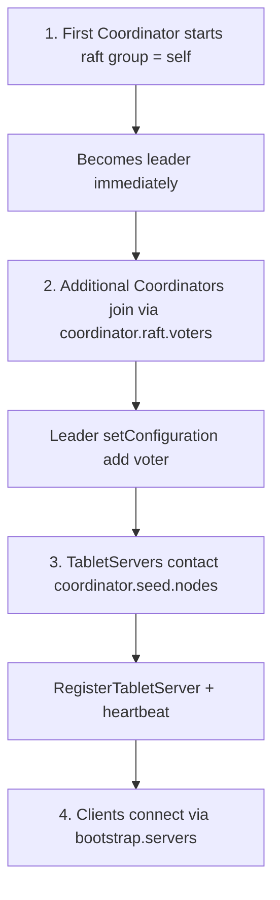

#### 5.4.2 TabletServer registration & liveness (replaces ephemeral znode + ZK session)

Today `ZooKeeperClient.registerTabletServer()` creates an **EPHEMERAL** node `/tabletservers/ids/[serverId]`; liveness = ZK session. Without ZK we replace this with **explicit registration + heartbeat lease**, exactly the KRaft `BrokerRegistration`/`BrokerHeartbeat` model (AutoMQ `metadata/` `ClusterControlManager`, `BrokerHeartbeatManager`).

**Wire path (implemented):**

| Step | Component | Behavior |
|------|-----------|----------|
| Register | `TabletServerRegistrationRpcServer` | Leader appends `REGISTER_TABLET_SERVER`, then `livenessManager.recordContact(serverId)` |
| Heartbeat | same RPC server | Renews lease iff membership key still present; otherwise returns `registered=false` (must re-register) |
| Lease expiry | `TabletServerLivenessManager` tick | Leader-only; expired `lastContact` → async `FENCE_TABLET_SERVER` append |
| Apply fence | `RaftMetadataStore.apply` | Deletes the membership key; `RaftTabletServerChangeWatcher` → `DeadTabletServerEvent` → `processDeadTabletServer` (cache eviction + `UpdateMetadata`) |
| Controlled shutdown | `CoordinatorEventProcessor.tryProcessControlledShutdown` | On success (no remaining leader buckets): `fenceImmediately(serverId)` — ZK ephemeral-delete parity without waiting for session-timeout |
| **Leadership seed (T6)** | `CoordinatorEventProcessor.startup` after `initCoordinatorContext` | Calls `seedRegisteredServers(store membership)` so REGISTER’d members that never heartbeated after a coordinator restart still expire |

**Why leadership seed is required (ZK parity gap closed 2026-08-09):**

- Under ZK, process exit / session death deletes the ephemeral node even if the coordinator was down; on CS restart the dead tablet is simply absent.
- Under Raft, `REGISTER_TABLET_SERVER` is a **persistent** log record. If a tablet dies while the coordinator is down (or never reconnects after CS restart), the membership key remains until someone appends `FENCE_TABLET_SERVER`.
- `lastContact` is **in-memory only** and is empty on a new leadership. Without seeding, lease expiry never runs for store members that are not already tracked → permanent zombies in `getAliveTabletServerInfos()` / metadata responses.
- `seedRegisteredServers` uses `putIfAbsent(id, now)` (grace = full `session-timeout`); live tablets renew via heartbeat; offline ones are fenced after timeout.

```java
// fluss-server/.../coordinator/raft/TabletServerLivenessManager.java (implemented)
void checkExpiredServers() {                       // scheduled tick, leader only
    long now = clock.milliseconds();
    for (Map.Entry<Integer, Long> e : lastContact.entrySet()) {
        if (now - e.getValue() > sessionTimeoutMs) {
            lastContact.remove(e.getKey());
            writer.append(new MetadataRecord(
                    MetadataRecord.Type.FENCE_TABLET_SERVER,
                    serverIdKey(e.getKey()), EMPTY));  // membership change is replicated
        }
    }
}

/** Called from CoordinatorEventProcessor after loading store membership on become-leader. */
void seedRegisteredServers(Iterable<Integer> serverIds) {
    long now = clock.milliseconds();
    for (Integer id : serverIds) {
        lastContact.putIfAbsent(id, now);            // do not reset an in-flight heartbeat
    }
}
```

**Config:** `coordinator.tablet-server.session-timeout` (default 30s; IT harness often 5s). Check interval reuses `coordinator.raft.heartbeat.interval` for the liveness scheduler cadence.

**ITs:** `TabletServerLivenessManagerITCase` (lease expiry + seeded-offline fence); `MetadataUpdateITCase` (default Raft — stop/start tablet + coordinator bounce asserts alive-set shrink); controlled-shutdown fence covered by tablet shutdown / RemoveOffline paths.

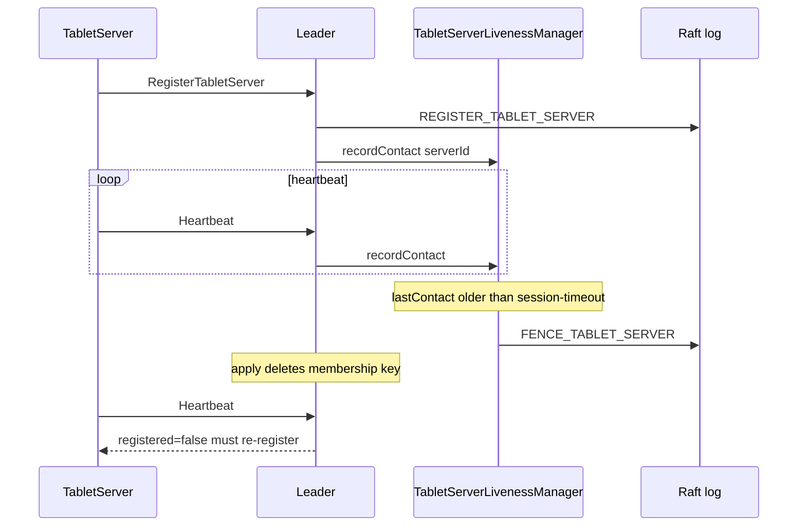

Leadership seed after CS restart: `seedRegisteredServers(store membership)` so offline `REGISTER` keys still expire (ZK ephemeral-expiry parity).

#### 5.4.3 Seed List Configuration

```yaml
# New configuration options (replace zookeeper.address / zookeeper.path.root)
coordinator:
  # Discovery seed list for TabletServers & clients (any coordinator host:port)
  seed.nodes: "node1:9123,node2:9123,node3:9123"
  raft:
    # Static voter set for the coordinator quorum (host:port list, Ratis peers)
    voters: "node1:9124,node2:9124,node3:9124"
    # This node's raft peer id (defaults to server id)
    node.id: "1"
    heartbeat.interval: 500ms
    election.timeout: 1000ms
    snapshot.trigger.threshold: 10000
    # Dedicated raft transport port (separate from client RPC port)
    port: 9124
    dir: "/data/fluss/raft"
```

#### 5.4.4 Gossip service discovery (optional)

§1.2 lists a **Gossip Protocol (optional)** so coordinators and TabletServers can discover peers without a complete static seed list. This is **not** a replacement for Raft membership (`coordinator.raft.voters`) or for the required bootstrap contact (`coordinator.seed.nodes` still selects the Raft backend). It only **expands** a partial seed list.

**Protocol (SWIM-style push-pull, no extra Maven deps):**

1. When `coordinator.gossip.enabled=true`, each Coordinator binds `coordinator.gossip.port` (default 9125; `0` = ephemeral) and advertises its RPC `host:port`.
2. Each round (`coordinator.gossip.interval`, default 1s) the node increments a heartbeat, picks a random known peer (or a seed host at `coordinator.gossip.port` if the view is still empty), and exchanges membership views over TCP.
3. Merge is incarnation-then-heartbeat; members not refreshed within `coordinator.gossip.failure-timeout` (default 10s) are dropped.
4. TabletServers with gossip enabled call `GossipDiscovery.expandRpcSeeds`: pull membership from each configured seed's gossip port and union the advertised RPC addresses onto `coordinator.seed.nodes` before `CoordinatorDiscovery`.

A cluster can still run with gossip off (the default) and a full static seed list. Gossip is a discovery convenience, never a consistency mechanism — metadata remains Raft-replicated.

**Config:** `coordinator.gossip.enabled` (default false), `coordinator.gossip.port`, `coordinator.gossip.interval`, `coordinator.gossip.failure-timeout`. Seeds reuse `coordinator.seed.nodes` hosts.

**Code:** `fluss-server/.../coordinator/gossip/{GossipService,GossipView,TcpGossipTransport,GossipDiscovery}`. Wired from `CoordinatorServer.initCoordinatorStandby` and `TabletServer.parseSeedNodes`.

### 5.5 API Compatibility Layer

`ZooKeeperClient` (`fluss-server/.../zk/ZooKeeperClient.java`, ~2200 lines) is referenced by `CoordinatorServer`, `TabletServer`, `MetadataManager`, `CoordinatorService`, `DynamicConfigManager`, `KvSnapshotLeaseManager`, `AuthorizerLoader`, and the coordinator event processor. Rather than change all call sites at once, we extract an interface that both backends implement — the same **dual-support** approach KRaft used during Kafka's ZK bridge phase.

#### 5.5.1 Extracted interface

New file: `fluss-server/src/main/java/org/apache/fluss/server/metadata/MetadataStoreClient.java`

```java
package org.apache.fluss.server.metadata;

import org.apache.fluss.annotation.Internal;
import org.apache.fluss.server.zk.data.CoordinatorAddress;
import org.apache.fluss.server.zk.data.TableRegistration;
import org.apache.fluss.server.zk.data.TabletServerRegistration;
// ... existing data classes reused verbatim

/**
 * Backend-neutral metadata + coordination client. Method signatures mirror the existing
 * {@code ZooKeeperClient} public API so call sites are backend-agnostic.
 *
 * <p>Two implementations:
 * <ul>
 *   <li>{@code ZooKeeperClient} (legacy) — already matches this surface; declared {@code implements}.
 *   <li>{@code RaftMetadataClient} (new) — delegates to {@link
 *       org.apache.fluss.server.coordinator.raft.RaftJournalWriter} +
 *       {@link org.apache.fluss.server.coordinator.raft.RaftMetadataStore}.
 * </ul>
 */
@Internal
public interface MetadataStoreClient extends AutoCloseable {

    // ---- coordinator / epoch (see ZooKeeperClient.java:234-346) ----
    void registerCoordinatorServer(CoordinatorAddress address) throws Exception;
    void registerCoordinatorLeader(CoordinatorAddress address) throws Exception;
    java.util.Optional<CoordinatorAddress> getCoordinatorLeaderAddress() throws Exception;

    // ---- tablet server (see ZooKeeperClient.java:361-399) ----
    void registerTabletServer(int serverId, TabletServerRegistration reg) throws Exception;
    java.util.Optional<TabletServerRegistration> getTabletServer(int serverId) throws Exception;
    int[] getSortedTabletServerList() throws Exception;

    // ---- table / assignment / leaderAndIsr (see ZooKeeperClient.java:404-...) ----
    void registerTable(org.apache.fluss.metadata.TablePath path, TableRegistration reg)
            throws Exception;
    java.util.Optional<TableRegistration> getTable(org.apache.fluss.metadata.TablePath path)
            throws Exception;
    void updateLeaderAndIsr(
            org.apache.fluss.metadata.TableBucket bucket, Object leaderAndIsr, int expectedEpoch)
            throws Exception;

    // ---- id counters ----
    org.apache.fluss.server.SequenceIDCounter tableIdCounter();
    org.apache.fluss.server.SequenceIDCounter partitionIdCounter();
    org.apache.fluss.server.SequenceIDCounter writerIdCounter();

    // ---- leader election (backend-specific impl, common LeaderElection contract, 5.1.5) ----
    // ZooKeeperClient returns a CoordinatorLeaderElection; RaftMetadataClient returns a
    // RaftLeaderSelector. CoordinatorServer holds the result as a LeaderElection (see 7.3.1).
    org.apache.fluss.server.coordinator.LeaderElection newLeaderSelector(String serverId);

    // ... (dynamic config, ACL, kv-snapshot lease, producer snapshot — one method per ZK op)
}
```

#### 5.5.2 Legacy adapter (near-zero behavior change)

`ZooKeeperClient` already exposes every data method above; we add `implements MetadataStoreClient` to its declaration (`ZooKeeperClient.java:177`) with **no data-method body changes**. The three `ZkSequenceIDCounter` fields already satisfy `tableIdCounter()` etc. Two small additions are needed to honor the interface:

1. `newLeaderSelector(serverId)` returns a `CoordinatorLeaderElection` (which now `implements LeaderElection`, 5.1.5) — this is exactly the object `CoordinatorServer` builds today at `CoordinatorServer.java:229`, just moved behind the factory.
2. `CoordinatorLeaderElection.currentEpoch()` returns a `ZkEpoch` (now `implements CoordinatorEpoch`) captured from `fenceBecomeCoordinatorLeader()` during `initLeaderServices` — i.e. the epoch it already obtains today, simply exposed. No new ZK round-trip.

These are additive; existing ZK behavior is unchanged.

#### 5.5.3 Raft implementation

```java
package org.apache.fluss.server.coordinator.raft;

import org.apache.fluss.server.metadata.MetadataStoreClient;

/**
 * Raft-backed {@link MetadataStoreClient}.
 *
 * <p><b>Consistency model (see 5.7):</b> ALL writes and strongly-consistent reads are served ONLY on
 * the leader. Writes go through the Raft log; a read on the leader is linearizable because the
 * leader's local store reflects every entry it has committed+applied. Followers keep an apply-lagged
 * copy used only for warm-standby failover (never for serving client reads). This mirrors KRaft,
 * where the active controller alone serves metadata reads/writes.
 */
public class RaftMetadataClient implements MetadataStoreClient {

    private final RaftJournalWriter writer;   // leader-only writes
    private final RaftMetadataStore store;     // local read view (leader = linearizable)
    private final RaftLeaderSelector leaderSelector;
    private final RaftSequenceIDCounter tableIdCounter;
    private final RaftSequenceIDCounter partitionIdCounter;
    private final RaftSequenceIDCounter writerIdCounter;

    @Override
    public void registerTable(
            org.apache.fluss.metadata.TablePath path,
            org.apache.fluss.server.zk.data.TableRegistration reg)
            throws Exception {
        requireLeader();
        byte[] payload =
                org.apache.fluss.server.zk.data.TableRegistrationJsonSerde.INSTANCE.serialize(reg);
        MetadataRecord rec =
                new MetadataRecord(MetadataRecord.Type.REGISTER_TABLE, path.toBytes(), payload);
        // append resolves after commit+local-apply; NO separate store.apply (single-writer, 5.1.4).
        writer.append(rec).get();
    }

    @Override
    public java.util.Optional<org.apache.fluss.server.zk.data.TableRegistration> getTable(
            org.apache.fluss.metadata.TablePath path) {
        requireLeader(); // strongly-consistent reads only on the leader (5.7)
        byte[] v = store.get(MetadataKeys.tableKey(path));
        return v == null
                ? java.util.Optional.empty()
                : java.util.Optional.of(
                        org.apache.fluss.server.zk.data.TableRegistrationJsonSerde.INSTANCE
                                .deserialize(v));
    }

    @Override
    public org.apache.fluss.server.coordinator.LeaderElection newLeaderSelector(String serverId) {
        return leaderSelector; // the RaftLeaderSelector built alongside this client
    }

    private void requireLeader() {
        if (!leaderSelector.isLeader()) {
            throw new org.apache.fluss.exception.CoordinatorNotLeaderException(
                    "This coordinator is not the raft leader; retry against the leader.");
        }
    }
    // ... remaining methods symmetric
}
```

#### 5.5.4 Backend selection

New file: `fluss-server/src/main/java/org/apache/fluss/server/metadata/MetadataBackend.java`

> **Implemented (2026-08-08):** default is **RAFT** when neither key is set. Existing ZK clusters
> must keep `zookeeper.address` set (and must **not** set `coordinator.seed.nodes`). Setting both
> keys fails fast with `IllegalConfigurationException`.

```java
public enum MetadataBackend {
    ZOOKEEPER,
    RAFT;

    /**
     * Backend resolution. Prefer an explicit key: zookeeper.address → ZOOKEEPER,
     * coordinator.seed.nodes → RAFT. Neither set → RAFT (current default on the Raft-removal
     * branch). Both set → IllegalConfigurationException.
     */
    public static MetadataBackend from(org.apache.fluss.config.Configuration conf) {
        boolean hasZk = conf.getOptional(ConfigOptions.ZOOKEEPER_ADDRESS).isPresent();
        boolean hasRaft = conf.getOptional(ConfigOptions.COORDINATOR_SEED_NODES).isPresent();
        if (hasZk && hasRaft) {
            throw new IllegalConfigurationException(
                    "Set exactly one of zookeeper.address or coordinator.seed.nodes.");
        }
        if (hasRaft) {
            return RAFT;
        }
        if (hasZk) {
            return ZOOKEEPER;
        }
        // Neither set: Raft is the default (Phase 5 / §9.1 Next Major behavior on this branch).
        return RAFT;
    }
}
```

In `CoordinatorServer.initCoordinatorStandby()` (`CoordinatorServer.java:226-229`) the two lines
```java
this.zkClient = ZooKeeperUtils.startZookeeperClient(conf, this);
this.coordinatorLeaderElection = new CoordinatorLeaderElection(zkClient, serverId);
```
become a factory dispatch:
```java
MetadataStoreClient metaClient = MetadataStoreClientFactory.create(conf, this, serverId);
this.leaderSelector = metaClient.newLeaderSelector(serverId); // RaftLeaderSelector or Curator-based
```
Every downstream constructor (`MetadataManager`, `CoordinatorService`, `KvSnapshotLeaseManager`, `DynamicConfigManager`, `AuthorizerLoader`) takes `MetadataStoreClient` instead of the concrete `ZooKeeperClient`.

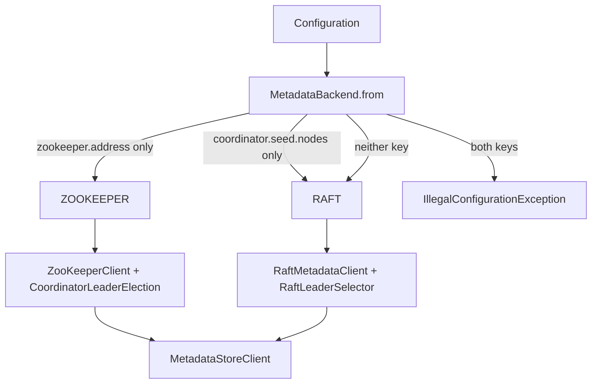

### 5.6 Thread Model

This is a first-class part of the design (Raft engines deadlock easily when the apply loop and the
write path are conflated). Threads and their strict rules:

```
┌────────────────────────┬───────────────────────────────────────────────────────────────┐
│ Thread / pool          │ What runs on it & rules                                         │
├────────────────────────┼───────────────────────────────────────────────────────────────┤
│ Ratis apply thread     │ FlussMetadataStateMachine.applyTransaction (single-threaded,    │
│ (owned by Ratis)       │ serial). Mutates RaftMetadataStore + fires in-process watches.  │
│                        │ RULE: MUST NOT block. MUST NOT call writer.append() or any      │
│                        │ .get() on an append future (self-deadlock: the future only      │
│                        │ completes when THIS thread advances the apply index).           │
├────────────────────────┼───────────────────────────────────────────────────────────────┤
│ RPC handler threads    │ Decode request -> writer.append(record) (async) -> compose on   │
│ (Netty/RPC pool)       │ the returned CompletableFuture -> reply. May call .get() only   │
│                        │ if the handler is explicitly a blocking one; prefer chaining.   │
├────────────────────────┼───────────────────────────────────────────────────────────────┤
│ leader-callback pool   │ RaftLeaderSelector gainPrimacy/losePrimacy: awaitCatchUp,       │
│ (cached, daemon)       │ init/cleanup leader services. Off the Ratis event thread (same  │
│                        │ reason the original CoordinatorLeaderElection used a pool).     │
├────────────────────────┼───────────────────────────────────────────────────────────────┤
│ liveness scheduler     │ TabletServerLivenessManager.checkExpiredServers: appends        │
│ (single scheduled exec)│ FENCE_TABLET_SERVER via writer.append() (async). Never blocks   │
│                        │ on the apply thread.                                            │
├────────────────────────┼───────────────────────────────────────────────────────────────┤
│ metadata-stream pool   │ Section 5.8: serves TabletServer/standby subscriptions; reads   │
│                        │ committed records, never writes.                                │
└────────────────────────┴───────────────────────────────────────────────────────────────┘
```

Golden rule: **all writes are asynchronous** (`RaftJournalWriter.append` returns a future, 5.2.3).
Any `.get()` on that future is permitted only on RPC/timer/id-allocation threads, **never** on the
Ratis apply thread. This is what makes the write path (id allocation 5.3, liveness fencing 5.4.2,
metadata CRUD 5.5.3) deadlock-free even though they conceptually "wait for commit".

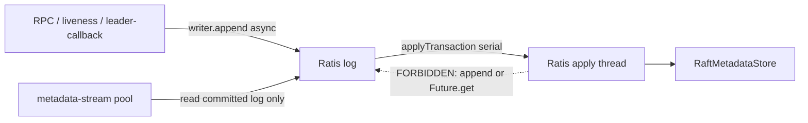

### 5.7 Read Consistency Model

ZK gives clients per-session monotonic reads; Raft followers hold apply-lagged copies. To avoid
serving stale metadata we adopt the **KRaft rule: only the leader serves metadata**:

| Access | Where it is served | Guarantee |
|--------|--------------------|-----------|
| Metadata write | Leader only (`requireLeader()`, else `CoordinatorNotLeaderException`) | Linearizable via Raft log |
| Strongly-consistent read (MetadataManager, CoordinatorContext, admin ops) | Leader only | Linearizable: leader's store reflects everything it committed+applied |
| Follower / standby local store | Never serves client reads | Warm standby only; used to speed up `gainPrimacy` catch-up |
| Client cache reads (best-effort, e.g. routing) | Any node's snapshot via the metadata stream (5.8), tagged with a metadata offset | Eventually consistent; client re-validates against leader on miss/stale-epoch |

Implementation: `RaftMetadataClient` guards both reads and writes with `requireLeader()` for the
authoritative path. Non-leaders return a redirect hint (leader address from
`getCoordinatorLeaderAddress()`), so callers retry against the leader — the same "not controller,
here's the controller" pattern KRaft uses. Optional future work: leader-lease reads / read-index to
allow follower reads with a freshness bound; explicitly out of scope for v1.

### 5.8 TabletServer Metadata Subscription (cross-process watch replacement)

This section fills the gap that a `ConcurrentHashMap` cannot: **how independent processes
(TabletServers, standby Coordinators, clients) observe metadata changes** without ZK watches. It is
the KRaft `MetadataLoader`/broker-metadata-stream model, made explicit as a Fluss RPC.

#### 5.8.1 Model: pull-based incremental stream keyed by metadata offset

Each committed `MetadataRecord` has a monotonically increasing **metadata offset** = its Raft log
index. TabletServers *pull* an ordered stream of records after a known offset (pull, not push, so
back-pressure and reconnect are trivial — the subscriber owns its cursor, exactly like a Kafka/Fluss
log consumer).

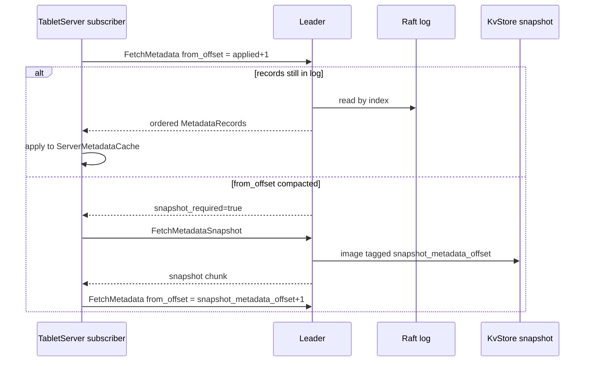

New RPC (proto2, `fluss-rpc`), leader-served:

```
message FetchMetadataRequest {
  required int32  server_id      = 1;  // subscriber tablet server id
  required int64  from_offset    = 2;  // last metadata offset the subscriber has applied (+1)
  required int64  leader_epoch   = 3;  // coordinator/raft epoch the subscriber last saw (fencing)
  optional int32  max_records    = 4;
  optional int32  max_wait_ms    = 5;  // long-poll: block up to this long if no new records
}

message FetchMetadataResponse {
  required int64  leader_epoch      = 1;  // current epoch; if > request.leader_epoch -> reset
  required int64  high_metadata_off = 2;  // leader's latest committed metadata offset
  repeated MetadataDeltaRecord records = 3;  // ordered, contiguous from request.from_offset
                                             // each wraps one MetadataRecord (5.1.3): {offset, bytes}
  optional bool   snapshot_required   = 4;  // true if from_offset <= leader's log start (compacted)
}

// Snapshot bootstrap for the "too old, already compacted" case. The snapshot is the KvStore TERMINAL
// STATE (key->value), NOT a delta sequence — so it MUST carry the exact metadata offset it reflects,
// otherwise the subscriber cannot know where to resume the delta stream (off-by-one = corruption).
message FetchMetadataSnapshotRequest {
  required int32  server_id    = 1;
  required int64  leader_epoch = 2;
}

message FetchMetadataSnapshotResponse {
  required int64  leader_epoch            = 1;
  // The metadata offset (== Raft log index) of the LAST record included in this snapshot. The
  // subscriber, after loading the snapshot, MUST resume streaming at from_offset = this + 1.
  required int64  snapshot_metadata_offset = 2;
  bytes           snapshot_chunk           = 3;  // streamed/chunked KvStore image (5.2.5)
  bool            last_chunk               = 4;
}
```

Semantics (mirrors KRaft broker metadata replay):

1. Subscriber persists its applied `metadata_offset` locally. On start/reconnect it sends
   `FetchMetadataRequest(from_offset = applied+1)`.
2. Leader returns records `[from_offset, high]` **by reading them back from its Raft log by index**
   (long-polls if none). Subscriber applies them **in order** to its local `ServerMetadataCache`,
   advancing its offset — the deterministic replay already implemented for followers (5.1.4) reused
   verbatim.
3. **Fencing:** if `leader_epoch` in the response exceeds what the subscriber knew, a coordinator
   failover happened; the subscriber revalidates leadership/routing. If `from_offset` is at or below
   the leader's log start (records were compacted into a snapshot), `snapshot_required=true` and the
   subscriber first pulls a full snapshot (5.2.5) via `FetchMetadataSnapshot`, then resumes streaming.
   This replaces ZK's "watch lost -> re-read" recovery.
4. **Snapshot ↔ offset binding (exact resume alignment).** A snapshot is a *terminal state image*
   (key→value), not a replayable delta log; the seam between "load snapshot" and "resume deltas" must
   be offset-exact. The rule:
   - Every snapshot is tagged with `snapshot_metadata_offset` = the Raft index of the **last record
     folded into it** (this equals `FlussMetadataStateMachine.lastAppliedIndex()` captured atomically
     when `takeSnapshot()` runs — see 5.2.5, and cf. Ratis `SnapshotInfo.getIndex()`).
   - After `FetchMetadataSnapshot`, the subscriber sets its applied offset to
     `snapshot_metadata_offset` and immediately issues `FetchMetadataRequest(from_offset =
     snapshot_metadata_offset + 1)`.
   - The leader guarantees its Raft log retains all indices `> snapshot_metadata_offset` (Ratis does
     not purge past the latest snapshot boundary that consumers still need), so the resume range is
     always contiguous — **no gap, no duplicate, no off-by-one**. If a subscriber somehow presents a
     `from_offset` that is neither in the log nor covered by the current snapshot, the leader answers
     `snapshot_required=true` again (restart bootstrap) rather than silently skipping.

**Leader-failover continuity (why this survives leader changes):** because the metadata offset IS the
Raft log index and the log is replicated to every voter, a newly-elected leader can serve **any**
`[from_offset, high]` range by reading its own (identical) log — it does not depend on any in-memory
state accumulated while it was a follower. So a subscriber holding a stale offset simply re-fetches
from the new leader with no gap. This is the crucial difference from a naive "buffer deltas in RAM"
design, which WOULD lose the stream across failover.

#### 5.8.2 Server side

New file: `fluss-server/src/main/java/org/apache/fluss/server/coordinator/raft/MetadataStreamService.java`

```java
/**
 * Leader-side service that streams committed metadata records to subscribers by offset.
 *
 * <p><b>Authoritative data source = the Raft log itself (read back by index), NOT an in-memory
 * queue.</b> This is what makes the stream leader-failover-safe (see 5.8.1): the log is identical on
 * every voter, so any elected leader can serve any historical [from_offset, high] range. Records too
 * old to be in the log (compacted) are served from the KvStore snapshot (5.2.5) via
 * FetchMetadataSnapshot.
 *
 * <p>{@code MetadataWatchService.fireWatch} is used ONLY as a wakeup signal: it completes the
 * long-poll waiters parked at "caught up" so they re-read the newly-appended tail from the log. It is
 * a notification, never the source of truth for record content.
 *
 * <p>Runs on the metadata-stream pool (5.6); read-only w.r.t. the log. On leadership loss it fails
 * in-flight long-polls with the current epoch so subscribers re-target the new leader.
 */
public class MetadataStreamService {

    private final org.apache.fluss.shaded.ratis.org.apache.ratis.server.raftlog.RaftLog raftLog;
    private final RaftMetadataStore store; // for snapshot bootstrap of compacted ranges
    // waiters parked at high watermark, keyed by fromOffset; completed by onApplied()
    // handleFetch(req): read raftLog[from_offset .. min(from_offset+max, high)]; if empty -> park

    /** Wakeup hook, called from the apply loop via MetadataWatchService. Content comes from the log. */
    public void onApplied(long metadataOffset) {
        // complete/advance parked long-poll waiters; they will read the tail from raftLog
    }
}
```

Note the state machine already exposes `awaitApplied(index)` / `lastAppliedIndex()` (5.1.4); the
stream service reuses `RaftLog` reads plus these signals, so no additional buffering is introduced.

#### 5.8.3 What this replaces

| ZK mechanism (cross-process) | Raft replacement (5.8) |
|------------------------------|------------------------|
| `ServerChangeWatcher` (tablet server membership) | `REGISTER/FENCE_TABLET_SERVER` records in the stream |
| `TableChangeWatcher` (assignment/leaderAndIsr changes) | `UPDATE_TABLE_ASSIGNMENT` / `UPDATE_PARTITION_ASSIGNMENT` / `UPDATE_LEADER_AND_ISR` records |
| ACL change notifications | `UPDATE_ACL` records |
| ZK watch lost + full re-read | `snapshot_required` + snapshot fetch, then resume |
| ephemeral-node session expiry | heartbeat lease + leadership `seedRegisteredServers` + `FENCE_TABLET_SERVER` (5.4.2) |

> **Scope/effort note:** 5.8 is a substantial, standalone workstream (new RPC, subscriber replay,
> snapshot bootstrap, reconnect/fencing) — not a sub-bullet of TabletServer integration. It is broken
> out as its own task in the (revised) plan (Section 7.2).

### 5.9 Security & Authorization

ZK removal changes the security surface, so this must be designed, not inherited. Today ZK security
(SASL + znode ACLs) protects the coordination channel; removing ZK introduces a **new Raft peer
transport** (port `coordinator.raft.port`, default 9124) and a new status RPC.

- **Raft inter-node transport (peer↔peer).** The Ratis gRPC transport between coordinators MUST
  support **TLS + mutual authentication**, gated by config. Without it, anyone who can reach 9124
  could inject metadata log entries. **Implemented:** `RaftMetadataServer.buildRaftProperties()` /
  `buildTlsParameters()` map `coordinator.raft.tls.enabled`, `.mutual-auth.enabled`,
  `.private-key.file`, `.cert-chain.file`, `.trust-store.file` → Ratis `GrpcConfigKeys.TLS.*` (+
  file-based `GrpcTlsConfig` Parameters when all three PEM paths are set). Default remains
  **TLS off** for local/dev; production profiles SHOULD enable TLS + mutual auth. **Firewall
  `coordinator.raft.port` (default 9124) to coordinators only** — never client-facing.
- **AuthZ on `GetCoordinatorRaftStatus` (5.7/7.4.5)** and any future admin RPC: guard with the same
  `Authorizer` used for cluster-describe operations (it exposes leader/topology). Treat it as a
  cluster-level `DESCRIBE` permission, not public.
- **ACL runtime read path.** The authorizer currently reads ACLs from ZK and watches
  `/fluss-acl-changes`. In Raft mode ACLs are `UPDATE_ACL` records (5.1.3) applied to the KvStore and
  propagated via the metadata stream (5.8); the authorizer reads them from the local
  `RaftMetadataStore`/cache and is notified by `MetadataWatchService` (in-process) or the stream
  (cross-process) — **no ACL functionality is lost**, only the backing store changes.
- **Migration secrecy.** The `ZkToRaftMigrationTool` (6.3) reads all metadata incl. ACLs; its
  export file MUST be treated as sensitive (restrict perms, no world-readable temp), per the Secrets
  rule.

### 5.10 Quorum Membership Reconfiguration & Sizing

An operational reality ZK operators take for granted: replacing a dead coordinator / scaling the
quorum. This needs explicit, safe procedures.

- **Sizing.** The coordinator quorum MUST be an **odd** number of voters (1, 3, 5). Recommended: 3
  for HA (tolerates 1 failure), 5 for higher fault tolerance (tolerates 2). **2 or 4 are
  discouraged** (even quorum: no availability gain, larger commit latency). Single-node (1) is dev
  only — no HA, but valid (the bootstrap case, 5.4.1).
- **Add a voter** (scale up / replace): start the new coordinator, then the leader applies a Ratis
  **`setConfiguration`** adding the new peer. The new voter
  first catches up via snapshot+log before it counts toward quorum, so availability is preserved.
- **Remove a voter** (decommission / replace dead node): leader applies `setConfiguration` removing
  the peer. **Safety rule:** never remove a voter if doing so would drop the live set below majority
  — the CLI/API must refuse a removal that breaks quorum, and reconfiguration is done **one node at a
  time** (Raft single-server membership change) to avoid losing majority.
- **New CLI (add to 7.4.3):** `fluss raft add-voter <host:raftPort>` / `fluss raft remove-voter
  <serverId>`, both leader-served, both validating the quorum-safety invariant and printing the
  resulting voter set (reuse the 7.4.5 status view).
- **Dead-node replacement runbook:** (1) `remove-voter <deadId>` (quorum still majority of the
  remaining live nodes), (2) provision replacement, (3) `add-voter <new>`; or use in-place replace if
  the node id/address is reused. Document that losing majority (e.g. 2 of 3 coordinators) requires
  the unsafe-recovery procedure in §9.4.

### 5.11 Record Schema Versioning & Upgrade / Downgrade

The metadata log is now **durable, replayable state** — its record format is a compatibility contract
across versions (ZK stored JSON per-znode; the Raft log stores an ordered history that a future
binary must still replay).

- **Per-record version byte.** `MetadataRecordCodec` already prefixes `[1B version]` (5.1.3). Bump it
  only additively; new fields ride inside the existing `*JsonSerde` payloads (JSON is forward-tolerant
  — unknown fields ignored), so a record written by vN is still applyable by vN+1.
  `MetadataRecordCodec.VERSION` is distinct from cluster `metadata.version`.
- **Cluster metadata feature gate (KRaft `metadata.version` analog).** **Implemented:** cluster
  `metadata.version` is persisted as `MetadataRecord.Type.UPDATE_METADATA_VERSION` (append-only enum
  ordinal at end). Voters advertise max support via
  `RaftMetadataClient.advertiseVoterMaxMetadataVersion` (v1 stub map; registration/heartbeat can
  replace later). The leader refuses `updateMetadataVersion(target)` when any known voter advertises
  a lower max, when `target` exceeds `MetadataVersions.CURRENT_METADATA_VERSION`, or when
  downgrading. See `MetadataVersionFeatureGateITCase`.
- **Rolling upgrade.** Upgrade coordinators one at a time; the new binary must apply the entire
  existing log (all historical record versions) — so **old record versions can never be dropped from
  the apply switch**, only deprecated. Snapshots (5.2.5) let a new binary skip ancient log, but it
  must still understand the snapshot format (version the snapshot too).
- **Downgrade.** Downgrade is only safe if no record/feature above the target's `metadata.version`
  has been written. State this limitation explicitly (same as KRaft): once the cluster upgrades
  `metadata.version`, downgrade requires a metadata downgrade step or is blocked.

### 5.12 Metrics & Observability

ZK exposed 4-letter-word/JMX metrics operators rely on; the Raft path must expose equivalents via
Fluss's existing `fluss-metrics` `MetricGroup` system (not a new mechanism). Minimum set on
coordinators:

| Metric | Meaning / alerting use |
|--------|------------------------|
| `raft.role` (leader/follower/candidate) | topology; alert if no leader > election timeout |
| `raft.term` / `raft.leaderElections` (count) | election churn; frequent elections = instability |
| `raft.commitIndex` / `raft.appliedIndex` / `raft.applyLag` | apply backpressure on this node |
| `raft.followerLag{serverId}` (commit − matchIndex) | slow/lagging follower (also in 7.4.5) |
| `raft.appendLatency` (p50/p99) | metadata write latency (the §8.4 target) |
| `raft.snapshot.{count,durationMs,sizeBytes}` | snapshot health |
| `metadataStream.subscriberLag{serverId}` | TabletServer falling behind the stream (5.8) |
| `raft.logSizeBytes` / `raft.logRetentionByLaggard` | log growth; a stuck subscriber pinning the log |

These feed the same reporters (Prometheus, etc.) already wired in Fluss, and back the CLI in 7.4.5.

**Implemented (minimum set):** `RaftMetrics.register()` on `CoordinatorServer` Raft startup exposes
`raftRole` / `raftTerm` / `raftCommitIndex` / `raftAppliedIndex` / `raftApplyLag` /
`raftFollowerLag` gauges on the coordinator `MetricGroup`, sourced from the owned Ratis
`Division` + `FlussMetadataStateMachine` (same data plane as `GetCoordinatorRaftStatus`). Role is
encoded as `0=follower`, `1=candidate`, `2=leader`. Histogram/`leaderElections` counters and
stream-subscriber lag remain follow-ups.

---

## 6. Migration Strategy

### 6.1 Dual-Support Phase

> **Status (2026-08-08): implemented** on `feature/zookeeper-removal-raft`. Selector is
> `MetadataBackend.from(Configuration)` (not the illustrative `MetadataBackendConfig` sketch below).
> Default is **RAFT** when neither key is set; see §5.5.4.

During transition, support both ZK and Raft modes:

```java
/**
 * Configuration to select metadata backend.
 */
public class MetadataBackendConfig {
    
    public enum BackendType {
        ZOOKEEPER,  // Legacy mode
        RAFT         // New mode
    }
    
    public static BackendType getBackendType(Configuration config) {
        if (config.containsKey("zookeeper.address")) {
            return BackendType.ZOOKEEPER;
        } else if (config.containsKey("coordinator.seed.nodes")) {
            return BackendType.RAFT;
        } else {
            // Default to RAFT in future versions
            return BackendType.RAFT;
        }
    }
}
```

### 6.2 Migration Steps

> **Timeline realism.** The month-numbered phases below are an **optimistic** best-case sketch, kept
> for shape. They predate the v2.1 scope additions (the cross-process metadata stream §5.8, leader
> catch-up §5.1.5, thread model §5.6) and the ×2 effort revision in §7.2. Treat the phase *ordering*
> as authoritative but the *durations* as lower bounds: a realistic GA is **~12-18 months**, gated by
> the hard long-poles (Raft core hardening, §5.8 stream stability, failure-injection). Re-baseline the
> calendar once Tasks 1/5/8 (§7.2) have real progress; do not commit externally to "Month 9 GA".

> **Progress (2026-08-08).** On this branch: Phase 1–5 are **complete in-repo** (dev, testing path,
> migration tool, Raft deploy/migration docs, Raft-default + ZK deprecated). Phase 6 (ZK removal) is
> **not started**. Calendar months in the diagram remain lower-bound sketches only; upstream Apache
> release / mailing-list soak is outside this branch.

```
┌─────────────────────────────────────────────────────────────────────┐
│                        Migration Timeline                            │
├─────────────────────────────────────────────────────────────────────┤
│                                                                     │
│  Phase 1: Development (Months 1-3)                    [DONE]       │
│  ┌─────────────────────────────────────────────────────────────┐   │
│  │ - Implement Raft module                                      │   │
│  │ - Implement new MetadataClient                               │   │
│  │ - Add dual-support mode                                      │   │
│  │ - Unit and integration tests                                 │   │
│  └─────────────────────────────────────────────────────────────┘   │
│                                                                     │
│  Phase 2: Testing (Month 4)                           [DONE]       │
│  ┌─────────────────────────────────────────────────────────────┐   │
│  │ - Deploy test clusters with Raft mode                        │   │
│  │ - Performance benchmarking                                   │   │
│  │ - Failure injection testing                                 │   │
│  │ - Compatibility testing                                     │   │
│  └─────────────────────────────────────────────────────────────┘   │
│  Covered in-repo: FlussClusterExtension Raft default,               │
│  DualBackendClusterITCase, §8.3 chaos ITs, §8.4 timing/perf ITs.   │
│                                                                     │
│  Phase 3: Migration Tool (Month 5)                    [DONE]       │
│  ┌─────────────────────────────────────────────────────────────┐   │
│  │ - Develop ZK-to-Raft migration tool                         │   │
│  │ - Data validation utilities                                 │   │
│  │ - Rollback procedures                                       │   │
│  └─────────────────────────────────────────────────────────────┘   │
│                                                                     │
│  Phase 4: Preview Release (Month 6)                   [DONE*]      │
│  ┌─────────────────────────────────────────────────────────────┐   │
│  │ - Release with Raft mode as experimental                    │   │
│  │ - Documentation for new deployment mode                     │   │
│  │ - Collect user feedback                                     │   │
│  └─────────────────────────────────────────────────────────────┘   │
│  * Docs + ops surface on branch; Apache RC / community soak =      │
│    release process (feedback via GitHub issues / mailing list).    │
│                                                                     │
│  Phase 5: General Availability (Month 9)              [DONE*]      │
│  ┌─────────────────────────────────────────────────────────────┐   │
│  │ - Raft mode becomes default                                 │   │
│  │ - ZK mode deprecated but supported                          │   │
│  │ - Migration guides published                                │   │
│  └─────────────────────────────────────────────────────────────┘   │
│  * Raft-default + ZK deprecation warning + website guides on       │
│    this branch; upstream GA cut is the release that merges them.   │
│                                                                     │
│  Phase 6: ZK Removal (Future Major Version)           [NOT STARTED]│
│  ┌─────────────────────────────────────────────────────────────┐   │
│  │ - Remove ZK support entirely                               │   │
│  │ - Remove ZK dependencies from codebase                     │   │
│  └─────────────────────────────────────────────────────────────┘   │
│                                                                     │
└─────────────────────────────────────────────────────────────────────┘
```

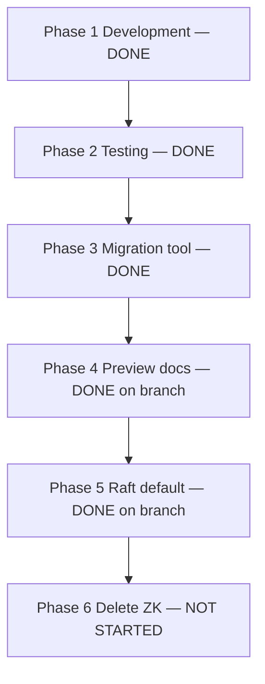

Calendar months in the ASCII sketch remain lower bounds. Upstream Apache RC / community soak is outside this branch.

### 6.3 Data Migration Tool

Because the KvStore key layout (5.2.1) is a mechanical rewrite of the existing `ZkData` znode paths,
migration is a recursive znode walk that re-emits each value as a `MetadataRecord` appended to a
fresh Raft group. All `*JsonSerde` classes are reused, so payloads are byte-identical.

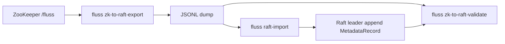

The simplest safe path is stop-the-world: fence ZK writes, export, import, switch `coordinator.seed.nodes`. Live re-scan converge is an optional downtime shrink, not a correctness crutch.

```java
package org.apache.fluss.server.tools.migration;

/** Migrates metadata from a ZooKeeper ensemble into a bootstrapped Raft coordinator quorum. */
public class ZkToRaftMigrationTool {

    /** Recursively read every znode under {@code /fluss} and dump {path, bytes} pairs. */
    public void exportZkMetadata(String zkAddress, java.nio.file.Path outputPath) throws Exception {
        try (ZooKeeperClient zk = ZooKeeperUtils.startZookeeperClient(confFor(zkAddress), null)) {
            for (String znode : walk(zk, ZkData.rootPath())) {
                byte[] value = zk.getData(znode);
                writeLine(outputPath, znode, value); // e.g. JSONL {"path":..,"b64":..}
            }
        }
    }

    /** Replay each exported znode as a MetadataRecord against a fresh Raft leader. */
    public void importToRaft(java.nio.file.Path inputPath, java.util.List<String> raftSeeds)
            throws Exception {
        try (RaftMetadataClient raft = RaftMetadataClient.connect(raftSeeds)) {
            for (ExportedZnode z : read(inputPath)) {
                MetadataRecord rec = ZnodeToRecordMapper.map(z.path, z.value); // path -> Type + key
                raft.appendRaw(rec); // leader append + commit; state machine applies
            }
            raft.awaitFullyApplied();
        }
    }

    /**
     * Live migration (minimal downtime). NOTE: ZK watches are edge-triggered and coalescing — two
     * rapid changes to a znode fire only one callback and the intermediate value is lost — so a
     * watch-based CDC would MISS updates. We therefore do NOT use watches for delta capture. Instead:
     * 1. Bootstrap Raft quorum, run importToRaft() to seed a baseline (record each source czxid).
     * 2. Converge by REPEATED full re-scan diff: re-list /fluss, compare each znode's czxid/mzxid
     *    against the imported baseline, and replay only changed nodes as MetadataRecords. Repeat
     *    until a scan observes zero diffs (the change rate must be low enough to converge; if not,
     *    fall back to the stop-the-world path below).
     * 3. Brief downtime window: fence writes on ZK (mark coordinator read-only), do ONE final
     *    re-scan diff to catch the last mutations, then flip clients to coordinator.seed.nodes.
     * 4. Validate: full prefix-scan of the Raft store vs a fresh ZK export must be byte-identical
     *    per key (payloads are produced by the same *JsonSerde, so equality is exact).
     *
     * Because step 3 already requires a write-fence, the simplest safe option is a pure
     * stop-the-world migration (export -> import -> switch) with no live phase; the re-scan converge
     * loop (step 2) is an optimization to shrink the downtime window, never a correctness crutch.
     */
    public void liveMigration(String zkAddress, java.util.List<String> raftSeeds) throws Exception {
        // Implemented: LiveMigrator re-scan mzxid diffs until quiet, then fence + final scan.
        // CLI: fluss zk-to-raft-live-migrate --zk-address … [--raft-seeds …] [--max-rounds N]
    }
}
```

Exposed as a CLI subcommand in `fluss-dist/src/main/resources/bin` (see 9.3), e.g.
`./bin/fluss zk-to-raft-export`, `./bin/fluss raft-import`, and
`./bin/fluss zk-to-raft-live-migrate`.

---

## 7. Implementation Plan

### 7.1 Module Structure

```
fluss-server/src/main/java/org/apache/fluss/server/
├── coordinator/
│   ├── CoordinatorServer.java        # MODIFIED: factory dispatch (5.5.4)
│   ├── CoordinatorLeaderElection.java# KEPT for ZK mode; RaftLeaderSelector for raft mode
│   └── raft/                          # NEW Raft package (Apache Ratis based)
│       ├── RaftMetadataServer.java        # embeds Ratis RaftServer (5.1.2)
│       ├── FlussMetadataStateMachine.java # BaseStateMachine apply loop (5.1.4)
│       ├── RaftLeaderSelector.java        # leadership -> init/cleanup (5.1.5)
│       ├── RaftEpoch.java                  # raft term == coordinator epoch (5.1.6)
│       ├── MetadataRecord.java             # typed replicated record (5.1.3)
│       ├── MetadataRecordCodec.java        # encode/decode
│       ├── MetadataKeys.java               # znode-path -> KvStore key (5.2.1)
│       ├── RaftMetadataStore.java          # KvStore-backed apply + read view (5.2.2)
│       ├── RaftJournalWriter.java          # leader append + wait commit (5.2.3)
│       ├── MetadataWatchService.java       # in-process watch dispatch (5.2.4)
│       ├── RaftSequenceIDCounter.java      # block-allocated ids (5.3.2)
│       ├── RaftMetadataClient.java         # MetadataStoreClient impl (5.5.3)
│       └── TabletServerLivenessManager.java# heartbeat lease fencing (5.4.2)
│
├── metadata/
│   ├── MetadataStoreClient.java      # NEW backend-neutral interface (5.5.1)
│   ├── MetadataBackend.java          # NEW backend selector enum (5.5.4)
│   └── MetadataStoreClientFactory.java# NEW factory
│
└── zk/                                # Existing ZK module (kept during dual-support)
    ├── ZooKeeperClient.java          # MODIFIED: add `implements MetadataStoreClient`
    └── ...
```

**Shading (Section 7 rules):** add a `fluss-shaded-ratis` relocation of `org.apache.ratis.*` →
`org.apache.fluss.shaded.ratis.org.apache.ratis.*`, mirroring how Curator/ZooKeeper are shaded
today (`org.apache.fluss.shaded.curator5.*`). Ratis pulls in a shaded gRPC + protobuf for its
transport, so relocate `org.apache.ratis.thirdparty.*` as-is.

### 7.2 Development Tasks (Detailed)

> **Effort realism (v2.0).** The v1.0 estimates were optimistic. A production-grade embedded
> consensus system — even on top of Ratis — plus snapshotting, dynamic membership, cross-process
> metadata streaming, and failure-injection hardening is a **multi-quarter** effort. Estimates below
> are revised roughly ×2 and the previously-hidden cross-process metadata stream (5.8) is broken out
> as its own top-level task (new Task 5). Treat the "Month 9 GA" in Section 6.2 as best-case; a more
> realistic GA is 12-18 months given Tasks 1/5/8 are the hard, unavoidable long poles.

#### Task 1: Raft Core (Ratis integration) — **DONE**
- **Effort**: 6-8 weeks
- **Dependencies**: `fluss-shaded-ratis` module
- **Deliverables**:
  - [x] `fluss-shaded-ratis` module + relocation rules
  - [x] `RaftMetadataServer` embed + config mapping (5.1.2)
  - [x] `FlussMetadataStateMachine` pure commit-apply + `awaitApplied` (5.1.4)
  - [x] `RaftLeaderSelector` gainPrimacy/losePrimacy + catch-up (5.1.5)
  - [x] `RaftJournalWriter` async append (5.2.3) + **thread model conformance (5.6)**
  - [x] Snapshot/compaction (takeSnapshot/loadSnapshot, 5.2.5)
  - [x] Unit tests (core path covered; >80% coverage target still aspirational)

#### Task 2: Metadata Store — **DONE**
- **Effort**: 4-6 weeks
- **Dependencies**: Task 1
- **Deliverables**:
  - [x] `RaftMetadataStore` apply + read view (5.2.2), `MetadataKeys` uniform header (5.2.1)
  - [x] `MetadataRecord`/codec (5.1.3)
  - [x] In-process `MetadataWatchService` (5.2.4)
  - [x] **Read consistency enforcement (leader-only reads, 5.7)**
  - [x] Integration tests
  - Note: production Raft path uses durable `RocksDBMetadataKvStore` under
    `coordinator.raft.dir/metadata-kv/`; unit/follower harnesses keep `InMemoryMetadataKvStore`

#### Task 3: Sequence ID Service — **DONE**
- **Effort**: 2 weeks
- **Dependencies**: Task 1, Task 2
- **Deliverables**:
  - [x] Block-allocated `RaftSequenceIDCounter` (5.3.2)
  - [x] **Per-counter no-reuse proof for writerId (5.3.3)**
  - [x] Performance + failover-gap tests (`RaftRemoteSequenceIDCounterPerfITCase`, gap-tolerant ITs)

#### Task 4: Coordinator Integration — **DONE**
- **Effort**: 6-8 weeks
- **Dependencies**: Task 2, Task 3
- **Deliverables**:
  - [x] `MetadataStoreClient` extraction + `RaftMetadataClient` (5.5)
  - [x] `CoordinatorServer` factory dispatch + raft-term epoch (7.3.1)
  - [x] Update HA tests (Raft default + ZK-pinned where needed)

#### Task 5: Cross-Process Metadata Stream (5.8) — **DONE**
- **Effort**: 4-6 weeks
- **Dependencies**: Task 2
- **Deliverables**:
  - [x] `FetchMetadata`/`FetchMetadataSnapshot` RPC (proto2, `fluss-rpc`)
  - [x] `MetadataStreamService` (leader-side, long-poll, offset/epoch fencing)
  - [x] Subscriber replay into `ServerMetadataCache` + snapshot bootstrap + reconnect
  - [x] Chaos / failover coverage (e.g. `RaftCoordinatorFailoverReconnectITCase`, stream ITs);
        `RaftStaleLeaderRejectITCase`, `RaftMinorityCannotCommitITCase` for §8.3 term-fence / quorum

#### Task 6: TabletServer Integration — **DONE** (dual-support)
- **Effort**: 4-6 weeks
- **Dependencies**: Task 5
- **Deliverables**:
  - [x] RPC registration + heartbeat lease (5.4.2), `TabletServerLivenessManager`
  - [x] Leadership lease seed (`seedRegisteredServers` from store membership in
        `CoordinatorEventProcessor.startup`) — ZK ephemeral-expiry parity when CS restarts
        while offline `REGISTER` keys remain
  - [x] Controlled-shutdown `fenceImmediately` when no remaining leader buckets
  - [x] Consume metadata stream (Task 5) in place of ZK watches (Raft path)
  - [x] Raft path has no ZK dependency; ZK path retained until Phase 6
  - [x] Liveness ITs: `TabletServerLivenessManagerITCase`; alive-set shrink under Raft:
        `MetadataUpdateITCase` (default backend)
#### Task 7: Configuration, Scripts & Migration CLI — **DONE** (core); ops extras open
- **Effort**: 3-4 weeks
- **Dependencies**: Task 2
- **Deliverables**:
  - [x] New config options (Appendix 11.2), backend selector (5.5.4, **Raft default**)
  - [x] bin script changes: gate ZK launch on `zookeeper.address` in `local-cluster.sh`/`fluss-console.sh`/`fluss-daemon.sh` (7.4.2); `config.sh` ZK heap keys kept for ZK mode
  - [x] New `bin/fluss` CLI: `raft bootstrap`, **`raft status`/`leader` (7.4.5)**
  - [x] `GetCoordinatorRaftStatus` RPC on `AdminReadOnlyGateway` backing `raft status` (7.4.5)
  - [x] ZK export + Raft import (6.3) via `ZkToRaftMigrationTool`
  - [x] Byte-level validation utility (`zk-to-raft-validate`)
  - [x] NOTE: no Admin/DDL CLI changes and no client-connection changes (7.4.1)
  - [x] `raft add-voter` / `remove-voter` (§5.10) — Add/RemoveRaftVoter RPC + FlussCli + quorum-safety
  - [x] `raft unsafe-recover` (§9.4) — offline `raft-meta.conf` rewrite to `{survivor}`; `--i-understand-data-loss` gate; `RaftUnsafeRecoverITCase`

#### Task 8: Testing and Stabilization — **MOSTLY DONE**
- **Effort**: 10-12 weeks
- **Dependencies**: All previous tasks
- **Deliverables**:
  - [x] Dual-backend IT path via `FlussClusterExtension` (default Raft) and `DualBackendFlussClusters` (HA ITs run ZK + Raft)
  - [x] Failure injection (8.3) — partial (failover/reconnect ITs); full deadlock/thread-model matrix open
  - [x] Performance benchmarks (8.4) — JMH in `fluss-jmh` (ZK vs 1-voter Raft); **full operation catalog** in §8.4
  - [x] Documentation — `server.yaml`, website deploy/config docs, helm values skewed to Raft
  - [x] StopReplica / RemoveOfflineReplica / Rebalance Raft parity (T9-4c): cascade LeaderAndIsr delete; fence-on-controlled-shutdown; ITs unpinned
  - [x] Every HA IT dual-parameterized (`NotifyLeaderAndIsr` / `AdjustIsr` / `StopReplica` / `MetadataUpdate` / `TabletServerShutdown` / `ReplicaFetcher` / `RebalanceManager` / `TableManager` / `CoordinatorServiceOrphanRpcs` / `CoordinatorHighAvailabilityITCase`)

### 7.3 File Modification Checklist (with concrete diffs)

#### 7.3.1 `CoordinatorServer.java`

Current code (verified `CoordinatorServer.java:226-229, 306-308`):
```java
// initCoordinatorStandby()
this.zkClient = ZooKeeperUtils.startZookeeperClient(conf, this);
this.coordinatorLeaderElection = new CoordinatorLeaderElection(zkClient, serverId);
...
// initCoordinatorLeader()
ZkEpoch zkEpoch = zkClient.fenceBecomeCoordinatorLeader(serverId);
```
Target:
```java
// initCoordinatorStandby()
this.metaClient = MetadataStoreClientFactory.create(conf, this, serverId); // ZK or Raft
this.leaderSelector = metaClient.newLeaderSelector(serverId);
...
// initCoordinatorLeader()  -- epoch is the fencing token; raft term in raft mode, no CAS round-trip
CoordinatorEpoch epoch = leaderSelector.currentEpoch();  // ZkEpoch or RaftEpoch (5.1.5/5.1.6)
CoordinatorContext ctx = new CoordinatorContext(epoch.coordinatorEpoch());
```
The `startElectLeaderAsync(this::initCoordinatorLeader, this::cleanupLeader)` call
(`CoordinatorServer.java:191`) is unchanged because `RaftLeaderSelector` keeps the same signature (5.1.5).

#### 7.3.2 `TabletServer.java`

`registerTabletServer()` (ephemeral znode) → `RegisterTabletServerRequest` RPC + heartbeat loop
(5.4.2). The ZK-session re-init listener
(`ZooKeeperUtils.registerZookeeperClientReInitSessionListener`, used at
`CoordinatorServer.java:301`) is replaced by heartbeat-driven re-registration.

#### 7.3.3 `MetadataManager`, `CoordinatorService`, `DynamicConfigManager`, `KvSnapshotLeaseManager`, `AuthorizerLoader`

Constructor parameter type changes `ZooKeeperClient` → `MetadataStoreClient` (compile-time only; all
method names identical). No body changes in ZK mode.

#### 7.3.4 Full checklist

**Core Server Files**
- [x] `CoordinatorServer.java` — factory dispatch + raft-term epoch (7.3.1)
- [x] `TabletServer.java` — RPC register + heartbeat (7.3.2)
- [x] `ServerBase.java` — thread through `MetadataStoreClient` / backend-aware startup

**New Raft files** — all classes in Section 5 (`coordinator/raft/**`, `metadata/**`) — **DONE** for dual-support

**ZooKeeper Module (kept during dual-support, removed in Phase 6)**
- [x] `ZooKeeperClient.java` — add `implements MetadataStoreClient` (5.5.2)
- [x] `CoordinatorLeaderElection.java` — kept for ZK mode only
- [x] `ZkSequenceIDCounter.java` / `ZkEpoch.java` — kept for ZK mode only
- [ ] Delete ZK module / shaded ZK dependency — **Phase 6**

**Configuration**
- [x] `ConfigOptions.java` — add `coordinator.seed.nodes`, `coordinator.raft.*` (Appendix 11.2)
- [x] `MetadataBackend.from()` validation (5.5.4); default **RAFT**
- [~] mark `zookeeper.*` `@Deprecated` — docs/conf deprecate; full annotation sweep optional

**Build**
- [x] `fluss-shaded-ratis` module + relocation rules (in-repo)
- [x] `fluss-server/pom.xml` — depend on shaded Ratis

**Tests**
- [x] Raft cluster / extension ITs (leader election, registration, stream — Section 8.2)
- [x] Parameterize existing HA/ITCases over `MetadataBackend` (ZK + Raft) via `DualBackendFlussClusters`

### 7.4 CLI, Scripts & Client Impact

A deliberate scoping question: **do metadata operations in the Fluss CLI need to change?** Short
answer: **there is no metadata DDL CLI to change** — Fluss has never exposed `create/drop/list
database|table` as CLI commands. All metadata DDL flows through the client **Admin API over RPC**, so
the ZK→Raft switch is invisible above the RPC boundary. The only CLI-layer work is (a) start/stop
scripts that must stop launching ZK, and (b) new operational tooling (migration + Raft bootstrap).

#### 7.4.1 What does NOT change (important)

| Surface | Why it is unaffected |
|---------|----------------------|
| **Metadata DDL** (`createDatabase`/`createTable`/`listTables`/`alterTable`/`createPartition`/ACLs…) | Defined on `Admin` (`fluss-client/.../client/admin/Admin.java`) and served via `AdminGateway` RPC (`fluss-rpc/.../rpc/gateway/AdminGateway.java`) → `CoordinatorService` → `MetadataManager`. Only `MetadataManager`'s backend (`MetadataStoreClient`, 5.5) is swapped ZK→Raft; **the Admin API, its RPCs, and Flink/Spark catalog code are untouched.** |
| **Client / CLI cluster discovery** | Clients connect via **`bootstrap.servers`** (`ConfigOptions.BOOTSTRAP_SERVERS`), resolved by `MetadataUpdater.initializeCluster()` against `AdminReadOnlyGateway` — **never via ZK** (the whole `fluss-client` module has zero ZK references). So `zookeeper.address` removal does not affect how clients/CLI reach the cluster. |
| **Server launch args** | `coordinator-server.sh` / `tablet-server.sh` still take `-c/--configDir` and `-D key=value` (`server/cli/CommandLineOptions.java`). Raft settings arrive as ordinary config (`-D coordinator.seed.nodes=…`), no new parser needed. |
| **`readiness-check.sh`** / `ClusterHealthReadinessCheck.java` | K8s readiness probe uses `TabletServerGateway.getClusterHealth` RPC; no ZK dependency. |

Consequence: **no new Admin/DDL commands, and no client-connection changes.** This also means Flink
SQL DDL (`CREATE TABLE ...`) and the Fluss catalog need no changes — they already call `Admin`.

#### 7.4.2 Start/stop scripts that MUST change (remove embedded ZK)

`fluss-dist/src/main/resources/bin/` — the ZK process launch must be removed:

- [x] `local-cluster.sh` — gate ZK start/stop on `zookeeper.address`; Raft mode skips ZK (5.4.1 / dual-support).
- [x] `fluss-console.sh` — keep `zookeeper` case for ZK mode only (commented dual-support).
- [x] `fluss-daemon.sh` — keep `zookeeper` case for ZK mode only (commented dual-support).
- [~] `config.sh` — `KEY_ZK_HEAP_MB` / `ZK_HEAP` retained for ZK mode until Phase 6.

All four are ZK-only in dual-support: gate them on `MetadataBackend` so ZK mode still works until
Phase 6 removal (e.g. only launch ZK when `zookeeper.address` is set).

#### 7.4.3 New operational CLI to ADD

There is no `bin/fluss` umbrella command today; ZK removal is the right moment to add a small one for
cluster lifecycle + migration + observability (aligns with §6.3 and §9.3):

- [x] `bin/fluss` dispatcher script + Java entrypoint (`FlussCli`).
- [x] `fluss raft bootstrap` — initialize/format the Raft data dir marker (`coordinator.raft.dir`) and voter set before first start.
- [x] `fluss raft status` / `fluss leader` — query current leader info (REQUIRED, see 7.4.5).
- [x] `fluss raft add-voter <host:raftPort>` / `fluss raft remove-voter <serverId>` — quorum
      reconfiguration with quorum-safety validation (§5.10).
- [x] `fluss raft unsafe-recover --i-understand-data-loss` — guarded quorum-loss recovery (§9.4).
- [x] `fluss zk-to-raft-export` / `fluss raft-import` / `fluss zk-to-raft-validate` / `fluss zk-to-raft-live-migrate` — migration tool
      (`ZkToRaftMigrationTool`, §6.3).

#### 7.4.4 Config file changes

- [x] `conf/server.yaml` — Raft-first (`coordinator.seed.nodes` + `coordinator.raft.*`); `zookeeper.*`
      kept commented / accepted for ZK mode during dual-support.
- [ ] `conf/zookeeper.properties` — delete once ZK mode is removed (Phase 6); until then keep for ZK
      mode only.

#### 7.4.5 Leader / Raft status query command (REQUIRED)

**Why it is required, not optional.** Today operators inspect coordination state directly in ZK, e.g.
`zkCli.sh get /fluss/coordinators/active` (current leader), `.../coordinators/epoch`, and the tablet
server / leader_isr znodes. Removing ZK **deletes this entire observability surface**. Unlike DDL
(which has the Admin API) there is currently **no user-facing way to ask "who is the leader / what is
the term / are all voters caught up"**. So this command is a functional requirement of ZK removal, not
a nice-to-have.

**Backing RPC (leader-served, read-only).** The CLI needs data that only the coordinator quorum
knows. Add one RPC on `AdminReadOnlyGateway` (`fluss-rpc/.../rpc/gateway/AdminReadOnlyGateway.java`)
so it is reachable from any node via `bootstrap.servers` (7.4.1) and returns a redirect hint if hit
on a follower:

```
message GetCoordinatorRaftStatusRequest {}   // no args; targets the coordinator quorum

message GetCoordinatorRaftStatusResponse {
  optional ServerNode leader        = 1;  // current leader (former /coordinators/active); empty if
                                          // an election is in progress
  optional int64      leader_epoch  = 2;  // == raft term (former /coordinators/epoch), 5.1.6
  optional int64      commit_index  = 3;  // leader commit index (metadata offset high watermark)
  optional int64      applied_index = 4;  // leader lastAppliedIndex (5.1.4)
  repeated VoterState voters        = 5;  // leader-only: per-voter id/address/role/matchIndex/lag.
                                          // empty when answered by a follower (see routing below)
  optional bool       is_raft_mode  = 6;  // false when cluster still runs in ZK mode
  optional ServerNode redirect      = 7;  // set by a follower for the leader-only portion: the CLI
                                          // retries once against this address (mirrors §5.7 hint)
}

message VoterState {
  required int32  server_id   = 1;
  required string address     = 2;
  required string role        = 3;  // LEADER | FOLLOWER | CANDIDATE
  required int64  match_index = 4;  // replicated index; (commit_index - match_index) = lag
}
```

Source of truth on the server: the fields come from Ratis
`RaftServer.Division.getInfo()` (`getCurrentTerm()`, `getCommitIndex()`, `getLastAppliedIndex()`) and
`getGroupInfo()`/`getRoleInfoProto()` for the per-follower `matchIndex` — the same primitives already
used by `RaftLeaderSelector.currentEpoch()`/`awaitCatchUp()` (5.1.5), so no new server state is
introduced. In **ZK mode** the same RPC is answered from `getCoordinatorLeaderAddress()` with
`is_raft_mode=false` and Raft-only fields left at defaults, so the command works in both backends
during dual-support.

**Routing / redirect — reconciliation with the §5.7 leader-only rule.** §5.7 routes *authoritative
metadata* reads/writes to the leader and has non-leaders throw `CoordinatorNotLeaderException` with a
leader-address hint. `GetCoordinatorRaftStatus` follows the *same* redirect pattern but with one
deliberate refinement, because the command's job is partly to *find* the leader (so it must tolerate
being called on a non-leader):

- **Leader identity** (`leader`, `leader_epoch`, `is_raft_mode`) is answerable on **any node** — a
  follower reads the current leader from its own Ratis `RoleInfoProto` (`getLeaderId()`), no redirect
  needed. This is what `fluss leader` uses, and why it works even when you don't yet know the leader.
- **Full quorum status** (per-voter `match_index`/lag, i.e. the follower table) is **leader-only** —
  only the leader tracks followers' match indices. A follower serving this either fills just the
  leader-identity fields and sets a `redirect=<leaderAddr>` hint (the CLI transparently retries once
  against the leader, exactly the §5.7 hint-then-retry flow), or forwards. If there is **no leader**
  (election in progress) it returns an empty leader → the CLI prints "no leader" and exits non-zero.

So there is no contradiction with §5.7: the *authoritative* portion (voter lag) obeys the identical
leader-only + redirect rule, while the *leader-discovery* portion is intentionally answerable
anywhere — a strict superset that never violates the §5.7 guarantee. (Consistency note added to close
the §7.4.5 ↔ §5.7 seam.)

**CLI behavior:**

```
$ ./bin/fluss raft status
Leader:        coordinator-2:9123  (server id 2)
Epoch (term):  7
Commit index:  10432    Applied index: 10432   (leader in sync)
Voters:
  id=1  coordinator-1:9124  FOLLOWER  matchIndex=10432  lag=0
  id=2  coordinator-2:9124  LEADER    matchIndex=10432  lag=0
  id=3  coordinator-3:9124  FOLLOWER  matchIndex=10429  lag=3
```

- Exit non-zero if there is no leader (election in progress) — useful for scripts/health gating.
- `fluss leader` is a thin alias printing just the leader address (the direct `zkCli.sh get
  /coordinators/active` replacement).
- Optional `--watch` to poll (default 2s; `--interval <ms>`), and `--json` for machine-readable output. Implemented: `fluss raft status --watch [--interval ms]`.

> Mapping: this command + RPC is the observability replacement listed in the ZK-removal impact — it is
> the ONLY genuinely new *user-facing* capability the switch requires (everything else is either
> unchanged, §7.4.1, or internal). Tracked under Task 7 (§7.2).

> Net: the CLI/DDL *user surface* is stable (Admin API + `bootstrap.servers` unchanged). The churn is
> confined to bin scripts (stop launching ZK) and net-new ops tooling (bootstrap/migration), which are
> already tracked under Task 7 (§7.2). No additional metadata command needs to be designed.

#### 7.4.6 Downstream client SDK impact (fluss-rust, Python, C++, Elixir)

The non-JVM clients (e.g. `fluss-rust` / `fluss-rs`, and its Python/C++/Elixir bindings) are pure
**client SDKs**. The same reasoning as §7.4.1 applies, verified against the `fluss-rust` source:

| Aspect | Finding (fluss-rust) | Impact |
|--------|----------------------|--------|
| Cluster discovery | Connects via `config.bootstrap_servers` (`crates/fluss/src/client/connection.rs`), resolves coordinator via `cluster.get_coordinator_server()` and per-bucket leaders from RPC metadata (`client/admin.rs`) | **None** — identical model to the Java client; no ZK involved |
| ZK references | **Zero** in the core `fluss` crate (grep for `zookeeper`/`coordinator_epoch` → 0 hits) | **None** |
| Coordinator epoch / leader term | Client never reads a coordinator-epoch field from RPC responses | **None** — the ZkEpoch→RaftEpoch change (5.1.6) is server-internal |
| DDL / read / write RPCs | Uses the same `AdminGateway` / tablet RPCs (`create_table`, scan, upsert, lookup) | **None** — protocol unchanged |
| **Integration test harness** | `crates/fluss-test-cluster` launches a **ZooKeeper Docker container** (`ZOOKEEPER_IMAGE=zookeeper:3.9.2`) and injects `zookeeper.address` into coordinator/tablet confs (`fluss-test-cluster/src/lib.rs:346-362, 441-444`) | **MUST change** in lockstep with the Fluss server image: when the pinned `FLUSS_VERSION` image switches to Raft mode, drop `start_zookeeper()` and replace `zookeeper.address` with `coordinator.seed.nodes` + `coordinator.raft.*` |
| New `GetCoordinatorRaftStatus` RPC (7.4.5) | Not present today | **Optional** — SDKs MAY add a `raft_status()` admin method for parity; not required for correctness |

**Conclusion:** the ZK removal has **no impact on the fluss-rust client API or wire protocol** — the
only required change in that repo is its **integration-test cluster harness** (`fluss-test-cluster`),
which must stop starting a ZK container and switch server config keys to Raft, gated on the Fluss
server image version. This is a cross-repo coordination item, not a Fluss (server) design change; it
is called out here so the release that flips the default to Raft (9.1) also bumps the SDK test
harnesses. The compatibility guarantee to advertise: **existing fluss-rust releases keep working
against a Raft-mode cluster unchanged**, because they only depend on `bootstrap.servers` + the stable
RPC surface.

---

## 8. Testing Strategy

### 8.1 Unit Tests

| Component | Test Cases |
|-----------|------------|
| Raft Module | Leader election, log replication, snapshot, membership change |
| Metadata Store | CRUD operations, watch mechanism, transaction |
| Sequence ID | Uniqueness, pre-allocation, rollback |
| Migration Tool | Export/import, data validation |

### 8.2 Integration Tests

Follows Fluss test conventions (JUnit 5 + AssertJ, `*ITCase`, `FlussClusterExtension`). HA
coordinator/replica ITs run on **both** backends through `DualBackendFlussClusters` +
`@EnumSource(MetadataBackend.class)` (or `@MethodSource` when combined with extra flags).
`FlussClusterExtension.builder().setMetadataBackend(...)` still pins a single backend when the
scenario is backend-specific (Raft-only stream/registration ITs). Coordinator HA
(`CoordinatorHighAvailabilityITCase`) is parameterized: ZooKeeper expires the leader session on a
2-node LeaderLatch; Raft closes the leader of a 3-voter quorum (majority remains) and restarts it
as a follower. `ZooKeeperExtension` is replaced by an in-process 3-node embedded Raft quorum for Raft
clusters.

```java
package org.apache.fluss.server.coordinator.raft;

import static org.assertj.core.api.Assertions.assertThat;
import static org.assertj.core.api.Assertions.assertThatThrownBy;

/** Integration test for the Raft-backed coordinator quorum. */
class RaftClusterITCase {

    @RegisterExtension
    static final FlussClusterExtension FLUSS_CLUSTER =
            FlussClusterExtension.builder()
                    .setMetadataBackend(MetadataBackend.RAFT)
                    .setNumOfCoordinators(3) // 3 raft voters
                    .setNumOfTabletServers(3)
                    .build();

    @Test
    void testLeaderElectionOnLeaderCrash() throws Exception {
        String leaderId = FLUSS_CLUSTER.waitAndGetCoordinatorLeader();
        FLUSS_CLUSTER.stopCoordinator(leaderId);
        String newLeader = FLUSS_CLUSTER.waitAndGetCoordinatorLeader();
        assertThat(newLeader).isNotEqualTo(leaderId);
    }

    @Test
    void testMetadataReplication() throws Exception {
        MetadataStoreClient leader = FLUSS_CLUSTER.leaderMetadataClient();
        leader.registerTable(TablePath.of("db", "t"), sampleRegistration());
        // every voter's local store converges to the same value
        for (MetadataStoreClient follower : FLUSS_CLUSTER.allMetadataClients()) {
            retryUntil(() -> follower.getTable(TablePath.of("db", "t")).isPresent());
            assertThat(follower.getTable(TablePath.of("db", "t"))).isPresent();
        }
    }

    @Test
    void testTabletServerRegistrationAndFencing() throws Exception {
        MetadataStoreClient leader = FLUSS_CLUSTER.leaderMetadataClient();
        assertThat(leader.getSortedTabletServerList()).hasSize(3);
        FLUSS_CLUSTER.pauseHeartbeat(/*serverId=*/ 2); // simulate hang
        retryUntil(() -> leader.getSortedTabletServerList().length == 2); // fenced via lease
        assertThat(leader.getSortedTabletServerList()).doesNotContain(2);
    }

    @Test
    void testWriteRejectedOnNonLeader() {
        MetadataStoreClient follower = FLUSS_CLUSTER.anyFollowerMetadataClient();
        assertThatThrownBy(() -> follower.registerTable(TablePath.of("db", "x"), sampleRegistration()))
                .isInstanceOf(CoordinatorNotLeaderException.class);
    }
}
```

### 8.3 Failure Injection Tests

| Failure Scenario | Expected Behavior | Guaranteed by | IT coverage |
|------------------|-------------------|---------------|-------------|
| Coordinator leader crash | New leader elected within election timeout (<1s target) | Ratis election; `RaftLeaderSelector.gainPrimacy` | `RaftClusterITCase`, `RaftLeaderElectionTimingITCase` |
| Stale leader resumes after GC pause | Its `append` rejected (`NotLeaderException`) | Raft term fencing (5.1.6) | **`RaftStaleLeaderRejectITCase`** |
| Raft log/snapshot corruption | Node fails fast on restart, re-syncs from leader snapshot | Ratis snapshot install | open (optional) |
| Network partition | Minority partition cannot commit; steps down | Raft majority quorum | **`RaftMinorityCannotCommitITCase`** (kill 2/3 voters) |
| TabletServer heartbeat lost | Server fenced after `session-timeout`; `FENCE_TABLET_SERVER` replicated | `TabletServerLivenessManager` (5.4.2) | `TabletServerLivenessManagerITCase` |
| Tablet offline while CS down / CS restart | New leader seeds leases from store; offline members expire then fence | `seedRegisteredServers` + lease tick (5.4.2) | `MetadataUpdateITCase` (Raft default); seeded-offline case in liveness IT |
| Controlled shutdown (clean stop) | Immediate `fenceImmediately` when no remaining leader buckets | `CoordinatorEventProcessor.tryProcessControlledShutdown` | tablet shutdown / RemoveOffline ITs |
| Disk full on a voter | Voter drops out of quorum; cluster survives with majority | Ratis flush failure handling | open |

### 8.4 Performance Benchmarks

> **Targets vs measured.** The original rows below mixed field-observation ZK numbers with
> **3-voter same-AZ NVMe** Raft *targets*. Those targets are still the production bar: a Raft
> metadata write needs a majority **fsync + network RTT**, so `&lt;5ms` p50 is only realistic
> within one AZ on local SSD with sub-ms RTT. **Measured numbers in this section are a 1-node
> loopback JMH baseline** (embedded Curator `TestingServer` vs single-voter Ratis), not a 3-voter
> production cluster. Cross-AZ write latency was not measured (bounded below by majority RTT).

#### Environment (measured 2026-08-16)

| Field | Value |
|-------|-------|
| Date | 2026-08-16 |
| OS / arch | Darwin 25.5.0, arm64 (macOS) |
| Java | TencentKona JDK 11.0.23 (`JAVA_HOME` Kona 11.0.23) |
| JMH | 1.27; AverageTime µs/op (startup: SingleShotTime ms/op) |
| Flags | warmup 2×1s, measurement 3×1s, `@Fork(0)` in-process, 1 thread (startup: 1 warmup + 3 single-shots) |
| Topology | **1-node**: local ZK `TestingServer` vs 1-voter embedded Ratis on loopback |
| Classes | `fluss-jmh` `MetadataPathBenchmark`, `MetadataStoreBenchmark`, `SequenceIdAllocationBenchmark`, `CoordinatorStartupBenchmark` |

Re-run (see `fluss-jmh/README.md`):

```bash
export JAVA_HOME=/path/to/jdk-11
./mvnw -pl fluss-jmh -am test-compile -DskipTests
./mvnw -pl fluss-jmh exec:java
```

#### Original metric table (targets kept; measured column filled)

| Metric | ZK Mode (measured, 1-node) | Raft Mode (3-voter NVMe *target*) | Conditions | Measured notes (this run) |
|--------|----------------------------|-----------------------------------|------------|---------------------------|
| Leader election time | ~5s (field, historical) | &lt;1s | 3 voters, `election.timeout=1s` | **Not in 1-node JMH.** `RaftLeaderElectionTimingITCase` (3-voter loopback): soft assert &lt;5s under CI; logs ms each run |
| Metadata write latency (p50) | **4.8 ms** store `registerTable` | &lt;5ms | same-AZ, NVMe, majority fsync+RTT&lt;1ms | JMH AverageTime ≈ p50 on unimodal data: ZK **4815 µs/op**, Raft 1-voter **8582 µs/op** (`MetadataStoreBenchmark.metadataWrite`). 1-voter Raft still fsyncs the local log; 3-voter + RTT will be higher |
| Metadata write latency (cross-AZ) | — | ~= majority RTT + fsync | bounded by physics | not measured |
| Metadata read latency (leader, p50) | **102 µs** store `getTable` | &lt;1ms | leader-local KvStore read (5.7) | ZK **102 µs/op**, Raft **1.6 µs/op** (`MetadataStoreBenchmark.metadataRead`) — Raft is an in-process KvStore get |
| Startup time (single node) | **99 ms** coordinator+ZK | &lt;10s (includes snapshot load) | coordinator + metadata backend, 0 tablet servers | ZK **99.3 ms**, Raft **194 ms** (`CoordinatorStartupBenchmark`, empty store; not a snapshot-reload case) |
| Sequence-id alloc (block vs 1:1) | **4.9 ms**/id (ZK CAS 1:1) | block ≪ 1-append/id | single-voter loopback | ZK **4871 µs/op**; Raft blockSize=1 **8194 µs/op**; Raft blockSize=64 **127 µs/op** (`SequenceIdAllocationBenchmark`). Production Raft default `id-block-size=1000` is **8.5 µs/op** |

\* Earlier “~10ms / ~5ms / ~30s” ZK figures were rough field observations and are **replaced** by the JMH column above for 1-node loopback.

#### JMH comparison (same machine, same flags)

Score is JMH AverageTime (3 measurement iterations); ± is JMH 99.9% CI (wide with n=3 — treat as a point estimate). `@Fork(0)` reuses one store backend and one Admin cluster per backend for the JVM (avoids Ratis port leaks). Delete-style store rows include a preceding unique-key create unless noted. Raft point-reads of a single key are typically ~1 µs (in-process KvStore); Raft **prefix scans** (`list*`, `getPartitions`, `getCurrentSchemaId`, …) sit around **330 µs** on this box.

##### Admin / RPC path (`MetadataPathBenchmark`, 1 coordinator + 1 tablet server)

Warm cluster (shared session). `createTable` / `dropTable` remain the heavy DDL path (assignment + ISR + tablet RPC). Store-level rows below isolate consensus.

| Operation | ZK µs | Raft µs | Notes |
|-----------|------:|--------:|-------|
| `createDatabase` | 5379 | 8145 | |
| `alterDatabase` | 5838 | 8375 | comment update |
| `dropDatabase` | 11382 | 16338 | create+drop empty db |
| `getDatabaseInfo` | 174 | 68 | |
| `databaseExists` | 166 | 62 | |
| `listDatabases` | 245 | 133 | |
| `createTable` | 46581 | 24713 | previous row kept; full DDL |
| `alterTable` | 351 | 81 | set `client.connect-timeout` (idempotent after first) |
| `dropTable` | 89312 | 43684 | create+drop |
| `getTableInfo` | 356 | 842 | previous row kept; warm cluster (cold IT cluster can add `metadata.stream.max-wait=100ms`) |
| `tableExists` | 160 | 63 | |
| `listTables` | 283 | 113 | |
| `createPartition` | 28827 | 16999 | 1-bucket partitioned log table |
| `dropPartition` | 57902 | 26147 | create+drop |
| `listPartitionInfos` | 18535 | 500 | |

##### Store-level — schema DDL / database

| Operation | ZK µs | Raft µs | Notes |
|-----------|------:|--------:|-------|
| `registerDatabase` | 4865 | 8372 | |
| `updateDatabase` | 4777 | 8561 | |
| `deleteDatabase` | 9827 | 17731 | create+delete |
| `getDatabase` | 101 | 1.0 | |
| `databaseExists` | 98 | 0.37 | |
| `listDatabases` | 101 | 328 | Raft prefix scan |
| `listDatabaseSummaries` | 131 | 330 | |
| `registerFirstSchema` | 20393 | 8784 | unique table path (ZK parent creates) |
| `registerSchema` | 4741 | 9335 | subsequent schema id |
| `getSchemaById` | 103 | 2.1 | |
| `getCurrentSchemaId` | 98 | 325 | Raft prefix scan |
| `getLatestSchemas` | 199 | 331 | |

##### Store-level — table / partition

| Operation | ZK µs | Raft µs | Notes |
|-----------|------:|--------:|-------|
| `registerTable` (`metadataWrite`) | 4815 | 8582 | **previous row kept** |
| `updateTable` | 4669 | 8379 | |
| `deleteTable` | 9373 | 16268 | create+delete |
| `getTable` (`metadataRead`) | 102 | 1.6 | **previous row kept** |
| `getTables` | 107 | 1.6 | batch of 1 |
| `tableExist` | 102 | 0.85 | |
| `listTables` | 101 | 329 | Raft prefix scan |
| `registerPartition` | 13973 | 16993 | assignment + metadata txn (2 keys) |
| `deletePartition` | 19131 | 24953 | create+delete metadata |
| `getPartition` | 101 | 1.1 | |
| `getPartitions` | 99 | 331 | Raft prefix scan |
| `getPartitionNumber` | 99 | 331 | |
| `getPartitionRegistrations` | 198 | 327 | |
| `getPartitionIdAndPaths` | 204 | 331 | |
| `getPartitionIds` | 101 | 1.2 | |
| `getPartitionNameAndIdsForTables` | 199 | 327 | |

##### Store-level — ISR / assignment

| Operation | ZK µs | Raft µs | Notes |
|-----------|------:|--------:|-------|
| `registerTableAssignment` | 4922 | 8709 | |
| `updateTableAssignment` | 4928 | 8163 | `MATCH_ANY` CAS |
| `deleteTableAssignment` | 9626 | 25441 | create+delete |
| `getTableAssignment` | 100 | 0.87 | |
| `getTablesAssignments` | 99 | 0.89 | batch of 1 |
| `listAssignedTableIds` | 98 | 328 | |
| `updatePartitionAssignment` | 4903 | 8253 | |
| `deletePartitionAssignment` | 19557 | 32866 | create assignment+metadata, then delete assignment |
| `getPartitionAssignment` | 101 | 0.90 | |
| `getPartitionsAssignments` | 102 | 0.94 | |
| `listAssignedPartitionIds` | 118 | 328 | |
| `registerLeaderAndIsr` | 15571 | 8518 | unique bucket; ZK epoch-wrapped create |
| `updateLeaderAndIsr` | 5009 | 8528 | |
| `getLeaderAndIsr` | 101 | 1.1 | |
| `getLeaderAndIsrs` | 100 | 1.2 | |
| `getBucketMetadataForTables` | 209 | 2.2 | |
| `getBucketMetadataForPartitions` | 205 | 1.4 | |

##### Store-level — tablet / coordinator registration

| Operation | ZK µs | Raft µs | Notes |
|-----------|------:|--------:|-------|
| `registerCoordinatorServer` | 4957 | 0.67 | Raft **no-op** (membership is the voter set) |
| `registerCoordinatorLeader` | 9748 | 8346 | ZK: unregister+create ephemeral singleton |
| `unregisterCoordinatorLeader` | 9866 | 17221 | includes restore register |
| `getCoordinatorLeaderAddress` | 103 | 1.7 | |
| `getCoordinatorServerList` | 101 | 1.7 | |
| `registerTabletServer` | 4768 | 8675 | unique id |
| `getTabletServer` | 108 | 1.7 | |
| `getTabletServers` | 100 | 1.7 | |
| `getSortedTabletServerList` | 98 | 326 | |

##### Store-level — ACL / config / tags / rebalance

| Operation | ZK µs | Raft µs | Notes |
|-----------|------:|--------:|-------|
| `createResourceAcl` | 4709 | 8920 | |
| `updateResourceAcl` | 4695 | 8649 | `MATCH_ANY` version |
| `conditionalDeleteResourceAcl` | 9733 | 16653 | create+delete |
| `getResourceAclWithVersion` | 102 | 1.3 | |
| `listResourcesByType` | 139 | 335 | |
| `insertAclChangeNotification` | 4998 | 0.002 | Raft **no-op** (stream is the notification) |
| `upsertServerEntityConfig` | 9846 | 8311 | ZK create-or-setData |
| `fetchEntityConfig` | 108 | 0.91 | |
| `registerRebalanceTask` | 4979 | 8463 | |
| `deleteRebalanceTask` | 9638 | 16597 | create+delete |
| `getRebalanceTask` | 102 | 0.34 | |
| `registerServerTags` | 9647 | 8656 | ZK: delete+create |
| `updateServerTags` | 4677 | 8772 | |
| `deleteServerTags` | 9819 | 16887 | delete+restore |
| `getServerTags` | 100 | 0.89 | |

##### Store-level — id allocation

| Operation | ZK µs | Raft µs | Notes |
|-----------|------:|--------:|-------|
| `getTableIdAndIncrement` (`allocateId`) | 5037 | 8.5 | **previous row kept**; Raft block=1000 |
| `getPartitionIdAndIncrement` | 5266 | 8.6 | same block allocator |
| `getWriterIdAndIncrement` | 5038 | 8.3 | same block allocator |

##### Store-level — snapshots / lake / producer / remote log

| Operation | ZK µs | Raft µs | Notes |
|-----------|------:|--------:|-------|
| `registerKvSnapshotLeaseMetadata` | 4984 | 8362 | |
| `updateKvSnapshotLeaseMetadata` | 4739 | 8461 | |
| `deleteKvSnapshotLease` | 9264 | 16222 | create+delete |
| `getKvSnapshotLeaseMetadata` | 101 | 1.3 | |
| `getKvSnapshotLeasesList` | 98 | 328 | |
| `tryRegisterProducerOffsets` | 4831 | 8557 | |
| `deleteProducerOffsets` | 9403 | 16886 | create+delete |
| `deleteProducerSnapshotIfVersion` | 9431 | 16597 | create+CAS delete |
| `getProducerOffsets` | 100 | 0.84 | |
| `getProducerOffsetsWithVersion` | 100 | 0.82 | |
| `listProducerIds` | 97 | 328 | |
| `upsertRemoteLogManifestHandle` | 5312 | 8380 | |
| `getRemoteLogManifestHandle` | 101 | 1.2 | |
| `listRemoteLogManifestHandles` | 200 | 329 | |
| `upsertLakeTable` | 4811 | 8373 | empty metadata list |
| `getLakeTable` | 100 | 0.82 | |
| `getLakeTableSnapshot` | 102 | 0.37 | absent table id (empty optional; reconstructing a real lake file is N/A) |
| `getLatestReadableLakeTableSnapshot` | 100 | 0.83 | |
| `registerTableBucketSnapshot` | 5002 | 8544 | |
| `deleteTableBucketSnapshot` | 9355 | 16535 | create+delete |
| `getTableBucketSnapshot` | 105 | 0.88 | |
| `getTableBucketLatestSnapshot` | 196 | 328 | |
| `getTableBucketAllSnapshotAndIds` | 199 | 327 | |
| `listBucketSnapshotIds` | 103 | 328 | |
| `getTableLatestBucketSnapshot` | 402 | 328 | |
| `getPartitionLatestBucketSnapshot` | 199 | 332 | |

##### Sequence-id block allocation (`SequenceIdAllocationBenchmark`)

| Mode | µs/op | ops/s |
|------|------:|------:|
| ZooKeeper 1:1 CAS | 4871 | ~205 |
| Raft blockSize=1 (one append/id) | 8194 | ~122 |
| Raft blockSize=64 | 127 | ~7.9k |

Block allocation matches §5.3: 64 ids per Raft append is ~64× faster than one-append-per-id on this box (`RaftSequenceIDCounterPerfITCase` remains the CI relative-cost check).

##### Not measured (still listed)

| Operation | Group | Reason |
|-----------|-------|--------|
| `batchRegisterLeaderAndIsrForTablePartition` / `batchUpdateLeaderAndIsr` | ISR | Same append path as single `register`/`updateLeaderAndIsr` (batch of 1 would not add information) |
| `newLeaderSelector` | election | Not a metadata read/write |
| `fenceTabletServer` | tablet | Raft-only; not on `MetadataStoreClient` |
| `deleteLeaderAndIsr` | ISR | Not on `MetadataStoreClient` |
| `UPDATE_METADATA_VERSION` | feature gate | Not on `MetadataStoreClient` |
| LeaderAndIsr churn / replica `leaderAndIsr` RPC | ISR | Needs a live 3-replica table; too heavy for JMH |
| Admin `createAcls` / `dropAcls` / `listAcls` | ACL | Needs authorizer enabled on the IT cluster |
| Admin `rebalance` / `listRebalanceProgress` / `cancelRebalance` | assignment | Needs 3 tablet servers + ISR churn |
| Admin kv/lake snapshot, `getTableStats`, `listRemoteLogManifests` | snapshots | Needs live replica / lake files |
| Admin `addServerTag` / `alterClusterConfigs` / `getClusterHealth` | config | Not a coordinator metadata-store round-trip in the JMH cluster |
| 3-voter leader election | election | `RaftLeaderElectionTimingITCase` (not 1-node JMH) |

---

## 9. Rollout Plan

### 9.1 Compatibility Matrix

| Fluss Version | ZK Mode | Raft Mode | Default |
|---------------|---------|-----------|---------|
| Current (main / released) | Supported | N/A | ZK |
| This branch (`feature/zookeeper-removal-raft`) | **Deprecated** (supported) | Supported | **Raft** |
| Next release after merge | Deprecated (supported) | Supported | Raft |
| Future major | Removed | Supported | Raft |

### 9.2 Deployment Guide (Raft Mode)

> Raft mode is selected simply by setting `coordinator.seed.nodes` (+ `coordinator.raft.voters`) and
> NOT setting `zookeeper.address` — there is no separate "enabled" flag (see 5.5.4). Env-var form maps
> to the config keys in Appendix 11.2.

#### Single-Node Deployment

```yaml
# docker-compose-single.yml
services:
  coordinator:
    image: fluss:latest
    environment:
      - COORDINATOR_SEED_NODES=localhost:9123
      - COORDINATOR_RAFT_VOTERS=localhost:9124
      - COORDINATOR_RAFT_DIR=/data/fluss/raft
    ports:
      - "9123:9123"   # client RPC
      - "9124:9124"   # raft transport
```

#### Multi-Node Deployment

```yaml
# docker-compose-cluster.yml
services:
  coordinator-1:
    image: fluss:latest
    environment:
      - COORDINATOR_SEED_NODES=coordinator-1:9123,coordinator-2:9123,coordinator-3:9123
      - COORDINATOR_RAFT_VOTERS=coordinator-1:9124,coordinator-2:9124,coordinator-3:9124
      - COORDINATOR_RAFT_NODE_ID=1

  coordinator-2:
    image: fluss:latest
    environment:
      - COORDINATOR_SEED_NODES=coordinator-1:9123,coordinator-2:9123,coordinator-3:9123
      - COORDINATOR_RAFT_VOTERS=coordinator-1:9124,coordinator-2:9124,coordinator-3:9124
      - COORDINATOR_RAFT_NODE_ID=2

  coordinator-3:
    image: fluss:latest
    environment:
      - COORDINATOR_SEED_NODES=coordinator-1:9123,coordinator-2:9123,coordinator-3:9123
      - COORDINATOR_RAFT_VOTERS=coordinator-1:9124,coordinator-2:9124,coordinator-3:9124
      - COORDINATOR_RAFT_NODE_ID=3

  tabletserver:
    image: fluss:latest
    # NOT a raft voter; discovers coordinators via seed.nodes and subscribes to the metadata stream
    environment:
      - COORDINATOR_SEED_NODES=coordinator-1:9123,coordinator-2:9123,coordinator-3:9123
```

### 9.3 Configuration Migration Guide

#### From ZK Mode to Raft Mode

1. **Export ZK metadata**:
   ```bash
   ./bin/fluss zk-to-raft-export --zk-address localhost:2181 --output /tmp/fluss-metadata.json
   ```

2. **Start Raft cluster**:
   ```bash
   # On each coordinator node
   ./bin/coordinator.sh --raft-mode --seed-nodes node1:9123,node2:9123,node3:9123
   ```

3. **Import metadata**:
   ```bash
   ./bin/fluss raft-import --input /tmp/fluss-metadata.json --raft-seeds node1:9123
   ```

4. **Update client configurations**:
   ```yaml
   # Before (ZK mode)
   zookeeper.address: localhost:2181
   
   # After (Raft mode)
   coordinator.seed.nodes: node1:9123,node2:9123,node3:9123
   ```

### 9.4 Backup & Disaster Recovery

ZK deployments have established backup/restore (snapshot the ZK data dir, transaction-log replay).
Removing ZK moves metadata into the Raft log + RocksDB KvStore, so an **equivalent DR story is
required** — it does not come for free.

- **Backup.** The authoritative copy is the replicated Raft state; for offline backup, take a
  **RocksDB checkpoint of a follower's metadata store** (consistent, tagged with its
  `snapshot_metadata_offset`, 5.2.5) plus the Raft log tail, on a schedule. Prefer backing up a
  follower to avoid load on the leader. The migration export format (6.3) doubles as a
  portable/human-inspectable logical backup.
- **Restore (normal).** Restore the checkpoint into a fresh coordinator's `coordinator.raft.dir`,
  `fluss raft bootstrap` a single-node group from it, then `add-voter` the rest (5.10).
- **Quorum loss (majority of coordinators lost) — unsafe recovery.** If ≥ majority voters are
  permanently lost, Raft cannot elect a leader (by design — this is the split-brain safeguard). A
  documented, **explicit-operator-action** unsafe-recovery path is required (cf. Ratis
  `local raftMetaConf` / Ozone SCM recovery and KRaft unsafe recovery): stop the survivor
  coordinator; from its `coordinator.raft.dir`, run
  `fluss raft unsafe-recover --i-understand-data-loss` (refuses without the flag). The tool rewrites
  on-disk `raft-meta.conf` to a singleton `{survivor}` configuration at `previousIndex + 1`
  (accepting possible loss of unreplicated commits), updates the bootstrap marker, and never runs
  automatically. Then set `coordinator.raft.voters` to the survivor only, start it, and
  `add-voter` replacements.
- **RPO/RTO note.** Raft's RPO for committed metadata is 0 within a surviving majority (durable on a
  quorum). RPO is only non-zero in the unsafe-recovery case above. Document this so operators size
  quorum (5.10) for their fault tolerance target.

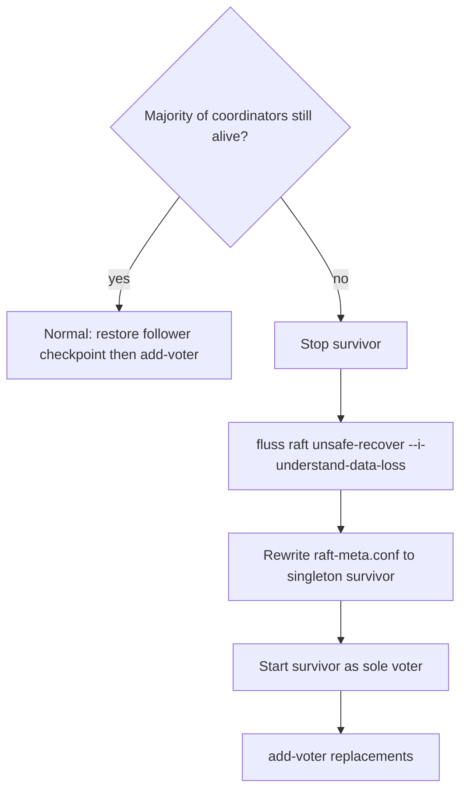

---

## 10. Risks and Mitigations

### 10.1 Technical Risks

| Risk | Impact | Likelihood | Mitigation |
|------|--------|------------|------------|
| Raft implementation bugs | High | Medium | Use Apache Ratis (proven); extensive failure-injection tests (8.3) |
| **State/log divergence from pre-apply** | High | — | **Eliminated by design**: rejected pre-apply, adopted pure commit-apply (5.1.4) |
| **Deadlock (append on apply thread)** | High | Medium | Async write path + explicit thread model (5.6); ban `.get()` on apply thread; test asserts |
| Stale reads on followers | Medium | Medium | Leader-only serving + redirect (5.7) |
| Cross-process watch gap underestimated | High | Medium | Metadata stream (5.8) scoped as its own task (7.2 Task 5) |
| Performance degradation | Medium | Low | Benchmarking with stated conditions (8.4); block-allocated ids (5.3) |
| Data loss during migration | High | Low | Re-scan-diff (not watch CDC) + byte-level validation + write-fence window (6.3) |
| Silent backend switch on config gap | Medium | Medium | Default backend = **Raft** on this branch (5.5.4); existing ZK clusters **must** keep `zookeeper.address` |
| Split-brain in Raft | High | Low | Raft term fencing (5.1.6); Ratis quorum |
| **Unauthenticated Raft peer port** | High | Medium | TLS + mutual auth on the raft transport; firewall to coordinators only (5.9) |
| **Permanent quorum loss (majority down)** | High | Low | Odd sizing + guarded unsafe-recovery CLI; backup/DR (5.10, 9.4) |
| **Mixed-version quorum writes unreadable records** | High | Low | `metadata.version` feature gate; additive record versioning (5.11) |

### 10.2 Operational Risks

| Risk | Impact | Likelihood | Mitigation |
|------|--------|------------|------------|
| User resistance to change | Medium | Medium | Clear documentation, migration tools |
| Lack of ZK expertise transfer | Low | High | Comprehensive Raft documentation |
| Upgrade failures | High | Medium | Thorough testing, rollback support |

### 10.3 Dependencies

- **Raft Library — DECISION: Apache Ratis.** Rationale: (1) production-proven as an *embeddable* Java Raft library — exactly Fluss's requirement per FAQ 11.4; (2) pluggable `StateMachine` maps cleanly onto Fluss's JSON metadata and RocksDB KvStore; (3) built-in snapshot, dynamic reconfiguration, and gRPC transport. Rejected alternatives: hand-written Raft (bug risk, see Risk table), KRaft (Kafka-coupled — AutoMQ only reuses it because it *is* Kafka).
- **KvStore Maturity**: Fluss already ships a RocksDB-backed `KvStore` (`fluss-server/.../kv/`) used for primary-key tables; the metadata store reuses it, so snapshots are RocksDB checkpoints.
- **Shading**: new `fluss-shaded-ratis` module relocating `org.apache.ratis.*` and `org.apache.ratis.thirdparty.*`.

---

## 11. Appendix

### 11.1 References

- [Raft Consensus Algorithm](https://raft.github.io/)
- [Apache Ratis](https://ratis.apache.org/) - Java Raft library (chosen engine)
- [ZooKeeper Replacement in other systems](https://kafka.apache.org/documentation/#kraft)
- Fluss Architecture Documentation
- **AutoMQ / Kafka KRaft** (`/opt/sourcecode/automq`, `raft/` + `metadata/`) — `RaftClient.Listener`, `QuorumState`/`EpochState`, `MetadataImage`/`MetadataDelta`, `BrokerRegistration`/`BrokerHeartbeat`.

### 11.2 Configuration Options (New)

```java
// --- Discovery / bootstrap ---
public static final ConfigOption<String> COORDINATOR_SEED_NODES =
    key("coordinator.seed.nodes")
    .stringType()
    .noDefaultValue()
    .withDescription("Comma-separated coordinator host:port seed list for TabletServers and "
        + "clients. Presence of this (and absence of zookeeper.address) selects Raft mode.");

public static final ConfigOption<Boolean> COORDINATOR_GOSSIP_ENABLED =
    key("coordinator.gossip.enabled")
    .booleanType()
    .defaultValue(false)
    .withDescription("Optional gossip discovery (§5.4.4). Default false: static seed list only.");

public static final ConfigOption<Integer> COORDINATOR_GOSSIP_PORT =
    key("coordinator.gossip.port")
    .intType()
    .defaultValue(9125)
    .withDescription("TCP port for gossip membership exchange.");

public static final ConfigOption<Duration> COORDINATOR_GOSSIP_INTERVAL =
    key("coordinator.gossip.interval")
    .durationType()
    .defaultValue(Duration.ofSeconds(1))
    .withDescription("Gossip push-pull round interval.");

public static final ConfigOption<Duration> COORDINATOR_GOSSIP_FAILURE_TIMEOUT =
    key("coordinator.gossip.failure-timeout")
    .durationType()
    .defaultValue(Duration.ofSeconds(10))
    .withDescription("Drop a gossip member not refreshed within this timeout.");

// --- Raft quorum ---
public static final ConfigOption<String> COORDINATOR_RAFT_VOTERS =
    key("coordinator.raft.voters")
    .stringType()
    .noDefaultValue()
    .withDescription("Static voter set (host:port) forming the coordinator Raft quorum.");

public static final ConfigOption<String> COORDINATOR_RAFT_NODE_ID =
    key("coordinator.raft.node.id")
    .stringType()
    .noDefaultValue()
    .withDescription("This node's Raft peer id; defaults to the coordinator server id.");

public static final ConfigOption<Integer> COORDINATOR_RAFT_PORT =
    key("coordinator.raft.port")
    .intType()
    .defaultValue(9124)
    .withDescription("Dedicated Raft transport port (separate from client RPC port).");

public static final ConfigOption<String> COORDINATOR_RAFT_DIR =
    key("coordinator.raft.dir")
    .stringType()
    .noDefaultValue()
    .withDescription("Local directory for the Raft log and metadata KvStore.");

public static final ConfigOption<Duration> COORDINATOR_RAFT_HEARTBEAT_INTERVAL =
    key("coordinator.raft.heartbeat.interval")
    .durationType()
    .defaultValue(Duration.ofMillis(500))
    .withDescription("Raft leader heartbeat interval.");

public static final ConfigOption<Duration> COORDINATOR_RAFT_CATCHUP_TIMEOUT =
    key("coordinator.raft.catchup.timeout")
    .durationType()
    .defaultValue(Duration.ofSeconds(30))
    .withDescription("Upper bound a newly-elected leader waits to apply the backlog up to its "
        + "leadership-gain commit index before serving (RaftLeaderSelector.awaitCatchUp, 5.1.5). "
        + "On timeout the node steps down and retries rather than serving stale reads.");

public static final ConfigOption<Duration> COORDINATOR_RAFT_ELECTION_TIMEOUT =
    key("coordinator.raft.election.timeout")
    .durationType()
    .defaultValue(Duration.ofMillis(1000))
    .withDescription("Raft election timeout upper bound; min is derived as half of this "
        + "(see RaftMetadataServer.buildRaftProperties, 5.1.2).");

public static final ConfigOption<Duration> COORDINATOR_RAFT_FIRST_ELECTION_TIMEOUT =
    key("coordinator.raft.first-election.timeout")
    .durationType()
    .defaultValue(Duration.ofMillis(300))
    .withDescription("Upper bound for the FIRST election on a fresh cluster, kept short so a "
        + "single-node/bootstrap cluster elects a leader quickly. Min is "
        + "derived as half of this.");

public static final ConfigOption<MemorySize> COORDINATOR_RAFT_LOG_SEGMENT_SIZE =
    key("coordinator.raft.log.segment-size")
    .memoryType()
    .defaultValue(MemorySize.parse("8 mb"))
    .withDescription("Max size of a Raft log segment (Ratis Log.setSegmentSizeMax).");

public static final ConfigOption<Integer> COORDINATOR_RAFT_SNAPSHOT_TRIGGER_THRESHOLD =
    key("coordinator.raft.snapshot.trigger.threshold")
    .intType()
    .defaultValue(10000)
    .withDescription("Number of committed log entries between automatic Raft snapshots.");

public static final ConfigOption<Long> COORDINATOR_RAFT_ID_BLOCK_SIZE =
    key("coordinator.raft.id-block-size")
    .longType()
    .defaultValue(1000L)
    .withDescription("Number of sequence ids reserved per Raft round-trip (see 5.3.2).");

// --- Raft TLS (§5.9); firewall coordinator.raft.port (9124) to coordinators only ---
public static final ConfigOption<Boolean> COORDINATOR_RAFT_TLS_ENABLED =
    key("coordinator.raft.tls.enabled").booleanType().defaultValue(false)
    .withDescription("Enable TLS on Raft peer gRPC (GrpcConfigKeys.TLS.enabled).");
public static final ConfigOption<Boolean> COORDINATOR_RAFT_TLS_MUTUAL_AUTH_ENABLED =
    key("coordinator.raft.tls.mutual-auth.enabled").booleanType().defaultValue(false)
    .withDescription("Mutual TLS between Raft peers when TLS is enabled.");
public static final ConfigOption<String> COORDINATOR_RAFT_TLS_PRIVATE_KEY_FILE =
    key("coordinator.raft.tls.private-key.file").stringType().noDefaultValue();
public static final ConfigOption<String> COORDINATOR_RAFT_TLS_CERT_CHAIN_FILE =
    key("coordinator.raft.tls.cert-chain.file").stringType().noDefaultValue();
public static final ConfigOption<String> COORDINATOR_RAFT_TLS_TRUST_STORE_FILE =
    key("coordinator.raft.tls.trust-store.file").stringType().noDefaultValue();

public static final ConfigOption<Duration> COORDINATOR_TABLET_SERVER_SESSION_TIMEOUT =
    key("coordinator.tablet-server.session-timeout")
    .durationType()
    .defaultValue(Duration.ofSeconds(30))
    .withDescription("Heartbeat lease timeout after which a TabletServer is fenced (replaces "
        + "the ZooKeeper ephemeral-node session, see 5.4.2).");

public static final ConfigOption<Duration> COORDINATOR_METADATA_STREAM_MAX_WAIT =
    key("coordinator.metadata-stream.max-wait")
    .durationType()
    .defaultValue(Duration.ofMillis(500))
    .withDescription("Long-poll wait for FetchMetadata when the subscriber is caught up (5.8).");
```

Deprecated (kept for ZK mode): `zookeeper.address`, `zookeeper.path.root`, `zookeeper.client.*`
(`ConfigOptions.java:686-778`) — annotate with `withDeprecatedKeys`/deprecation note.

### 11.3 Reference-Implementation Mapping

How each Fluss design element maps to AutoMQ / Kafka KRaft (the studied ZK-removal codebase whose *patterns* we adopt):

| Fluss element (this doc) | AutoMQ / KRaft |
|--------------------------|----------------|
| `RaftMetadataServer` (5.1.2) | `KafkaRaftManager` / `KafkaRaftClient` |
| `FlussMetadataStateMachine` (5.1.4) | `QuorumController` impl `RaftClient.Listener#handleCommit` |
| Apply model (5.1.4) | **adopted** KRaft pure commit-apply (applies on commit only; no leader pre-apply) |
| Write path async (5.2.3, 5.6) | `RaftClient.scheduleAtomicAppend` (async) |
| Read consistency (5.7) | active-controller-only reads |
| `RaftLeaderSelector` (5.1.5) | `QuorumState.transitionToLeader:550`, `RaftClient.Listener#handleLeaderChange` |
| Epoch = Raft term (5.1.6) | `QuorumState` leader epoch fencing |
| `MetadataRecord` (5.1.3) | `ApiMessageAndVersion` records (`metadata/*.json`) |
| `RaftMetadataStore` apply (5.2.2) | `MetadataDelta`/`MetadataImage` |
| Cross-process metadata stream (5.8) | `MetadataLoader` / broker metadata stream (pull by offset) |
| `RaftSequenceIDCounter` blocks (5.3.2-5.3.3) | `ProducerIdControlManager` id blocks |
| TabletServer heartbeat lease (5.4.2) | `BrokerRegistration`/`BrokerHeartbeatManager` |
| Snapshots (5.2.5) | `SnapshotWriter`/`SnapshotReader` |

### 11.4 FAQ

**Q: Why not use Apache Kafka's KRaft?**
A: KRaft is tightly coupled with Kafka. Fluss needs a lightweight, embeddable solution — hence Apache Ratis. We do borrow KRaft's *patterns* (commit-apply, listener callbacks, record replay, broker heartbeat), see Appendix 11.3.

**Q: Can I run mixed ZK and Raft clusters?**
A: No, during migration you need to choose one mode. The migration tool helps transition.

**Q: What happens to my existing ZK-based deployment?**
A: It continues to work in ZK mode as long as `zookeeper.address` remains set (and `coordinator.seed.nodes` is not). Use the migration tool when ready to switch. On the Raft-removal branch the **default** backend is Raft when neither key is set (5.5.4 / §9.1) — upgrades of ZK clusters must keep an explicit `zookeeper.address`.

**Q: Is Raft mode production-ready?**
A: Dual-support + Raft-default are implemented on `feature/zookeeper-removal-raft` and covered by extension ITs. Treat GA readiness as gated by remaining Task 8 depth, §5.9–5.12 ops surfaces, and Phase 6 deletion. Follow release notes.

**Q: Can followers serve reads?**
A: Not in v1. Only the leader serves authoritative reads/writes (5.7); non-leaders redirect to the leader. Best-effort client caches are fed by the eventually-consistent metadata stream (5.8).

### 11.5 Revision History

| Date | Version | Changes |
|------|---------|---------|
| 2026-06-29 | 1.0 | Initial draft |
| 2026-07-04 | 2.0 | Code-line-level detailed design. Chose Apache Ratis as the embedded Raft engine. Added concrete classes: `RaftMetadataServer`, `FlussMetadataStateMachine`, `RaftLeaderSelector`, `MetadataRecord`, `RaftMetadataStore`, `RaftJournalWriter`, `MetadataWatchService`, `RaftSequenceIDCounter`, `MetadataStoreClient`/`RaftMetadataClient`, `TabletServerLivenessManager`. Mapped every `ZkData` znode → KvStore key; term-based fencing; heartbeat-lease server liveness; concrete file diffs for `CoordinatorServer`; reference-implementation mapping table (AutoMQ / KRaft). |
| 2026-07-04 | 2.2 | Second-review fixes. (A) Removed residual pre-apply wording in §5.2.3 intro (now pure commit-apply, future resolves after local apply). (B) Clarified §5.8 stream **data source = Raft log read-by-index / KvStore snapshot**, NOT an in-memory queue; `fireWatch` is only a long-poll wakeup — added leader-failover-continuity argument. (C) Defined `awaitCatchUp` mechanism in §5.1.5: `commitIndex = division.getInfo().getCommitIndex()` then `awaitApplied(commitIndex)` with bounded timeout; added `RAFT_GROUP_ID` constant and `catchUpTimeoutMs`. (E) Added explicit timeline-realism caveats to §6.2 (~12-18 months GA, durations are lower bounds). Note: (D) `RaftMetadataServer.conf` was already stored since v2.1. |
| 2026-07-04 | 2.3 | Third-review follow-up (non-blocking detail). Nailed the **snapshot ↔ metadata-offset binding** in §5.8: added `FetchMetadataSnapshot` RPC carrying `snapshot_metadata_offset` (= Raft index of the last record folded into the snapshot), and semantics point 4 specifying exact resume alignment (`from_offset = snapshot_metadata_offset + 1`, log retention guarantee, restart-bootstrap fallback). §5.2.5 now requires `takeSnapshot()` to tag the image with `lastAppliedIndex` atomically (== `SnapshotInfo.getIndex()`) and `loadSnapshot()` to restore it, so snapshot bootstrap → delta resume never goes off-by-one. |
| 2026-07-04 | 2.4 | **Internal consistency audit** (data & semantic self-consistency). Fixed cross-symbol contradictions introduced across revisions: (1) introduced a shared **`LeaderElection`** interface (startElectLeaderAsync/isLeader/currentEpoch/close) implemented by both `CoordinatorLeaderElection` (ZK) and `RaftLeaderSelector` (Raft), so `CoordinatorServer` is backend-agnostic; (2) declared **`newLeaderSelector()`** in `MetadataStoreClient` (was used in §5.5.4/§7.3.1 but undeclared) and implemented it in both backends; (3) added **`currentEpoch()`** to the selector + shared **`CoordinatorEpoch`** interface (`ZkEpoch`/`RaftEpoch` both implement it); gave `RaftEpoch` a real `RaftEpoch(long)` ctor; fixed §7.3.1 to use `CoordinatorEpoch` not `RaftEpoch`; (4) added the missing **`coordinator.raft.catchup.timeout`** config backing `catchUpTimeoutMs`; (5) aligned enum names in prose (`UPDATE_TABLE_ASSIGNMENT`/`UPDATE_PARTITION_ASSIGNMENT`, not `UPDATE_ASSIGNMENT`); (6) clarified `MetadataDeltaRecord` wraps a `MetadataRecord`; (7) fixed `catchUpTimeout`→`catchUpTimeoutMs` and added `@Override`s. No behavioral design change — purely making the code snippets and cross-references type-check and agree. |
| 2026-07-04 | 2.5 | Consistency-audit follow-up (enum ↔ apply coverage). (Obs.1) Added explicit ellipsis comment in the `RaftMetadataStore.apply` switch clarifying that all non-DELETE/FENCE types are uniform key puts. (Obs.2) Added a **record-type → apply-semantics → section** table after the `MetadataRecord` enum (§5.1.3) so no enum value is "defined but undescribed"; explicitly linked `ALLOCATE_ID_RANGE` to §5.3.2/§5.3.3. **Removed `BUMP_COORDINATOR_EPOCH`** from the enum: it contradicted §5.1.6 (the Raft term subsumes the epoch and is never written to the metadata log); replaced with an explicit NOTE documenting the absence. |
| 2026-07-04 | 2.6 | Added **§7.4 CLI, Scripts & Client Impact**. Documented that metadata DDL has **no CLI to change** (all via `Admin` API/`AdminGateway` RPC) and client discovery via `bootstrap.servers` is **unaffected** (fluss-client has zero ZK refs); enumerated the bin scripts that must stop launching ZK (`local-cluster.sh`/`fluss-console.sh`/`fluss-daemon.sh`/`config.sh`), the net-new `bin/fluss` ops CLI (`raft bootstrap`/`raft status` + migration subcommands), and config-file changes. Expanded §7.2 Task 7 accordingly. |
| 2026-07-04 | 2.7 | Promoted the **leader-info query CLI to REQUIRED** and specified it (new §7.4.5): ZK removal deletes the `zkCli.sh get /coordinators/active` observability surface, so `fluss raft status` / `fluss leader` is a functional requirement. Added the backing **`GetCoordinatorRaftStatus` RPC** on `AdminReadOnlyGateway` (leader/term/commit/applied/voter-lag, sourced from Ratis `Division.getInfo()`; works in ZK mode with `is_raft_mode=false`), CLI output format, and `--watch/--json` options. Wired into §7.2 Task 7. |
| 2026-07-04 | 2.8 | Added **§7.4.6 Downstream client SDK impact** (fluss-rust/Python/C++/Elixir). Verified against `fluss-rust` source: the core `fluss` crate has **zero ZK refs** and connects only via `bootstrap.servers` + stable RPCs, so **client API/wire protocol are unaffected**; existing SDK releases keep working against a Raft-mode cluster. The **only** required change in that repo is its `fluss-test-cluster` harness, which launches a ZK Docker container and injects `zookeeper.address` (`lib.rs:346-362,441-444`) — it must drop ZK and switch to `coordinator.seed.nodes`/`coordinator.raft.*` in lockstep with the Fluss server image (9.1). Optional: add a `raft_status()` SDK method mirroring the new RPC. |
| 2026-07-04 | 2.9 | Closed the last open seam (§7.4.5 ↔ §5.7). Clarified the `GetCoordinatorRaftStatus` **routing/redirect** semantics: leader-identity fields are answerable on **any node** (a follower reads its Ratis `getLeaderId()`), so `fluss leader` works even without knowing the leader; the leader-only portion (per-voter `match_index`/lag) obeys the **identical §5.7 leader-only + redirect-hint** rule — a follower fills the identity fields and sets `redirect=<leaderAddr>`, the CLI retries once. Made response fields `optional` (empty `leader` during elections) and added the `redirect` field to the proto. No contradiction with §5.7 — the authoritative portion is a strict subset of the leader-only rule. |
| 2026-07-04 | 3.0 | **Production-readiness gap fill** (5 previously-missing dimensions). Added **§5.9 Security & Authorization** (TLS+mutual-auth on the new Raft peer port; authz on the status RPC; ACL runtime read path; migration-export secrecy). **§5.10 Quorum Membership & Sizing** (odd 1/3/5 sizing; add/remove-voter via Ratis reconfiguration with quorum-safety; dead-node runbook; new `raft add-voter/remove-voter` CLI). **§5.11 Record Schema Versioning & Upgrade/Downgrade** (per-record version byte; `metadata.version` feature gate; rolling-upgrade apply-all-history rule; downgrade limits). **§5.12 Metrics & Observability** (Raft/stream metrics via `fluss-metrics`). **§9.4 Backup & Disaster Recovery** (RocksDB-checkpoint backup; normal restore; guarded `unsafe-recover` for quorum loss; RPO/RTO). Wired new CLI into §7.4.3 and 3 new rows into the §10.1 risk table. |
| 2026-07-04 | 3.1 | Navigation: added a top **Quick nav** bar under the title and expanded the **Table of Contents into a nested TOC** with anchor links for every subsection (incl. §5.1–5.12 and §7.4.1–7.4.6). Documentation-only change. |
| 2026-08-08 | 3.2 | **Implementation progress sync.** Dual-support (Tasks 1–7) and Raft-as-default are landed on `feature/zookeeper-removal-raft` (`977d6aef7`, `0f2fc37da`). Added top **Implementation Progress** table; marked §7.2 / §7.3.4 / §7.4 checkboxes; updated §5.5.4 + FAQ + §9.1 for Raft default; left Phase 6 and `add-voter`/`unsafe-recover` open; noted Task 8 residual gaps. |
| 2026-08-08 | 3.3 | **T9-2/T9-3 ops CLI.** `raft add-voter`/`remove-voter` (Ratis `setConfiguration` + quorum-safety) and guarded `raft unsafe-recover --i-understand-data-loss` (offline `raft-meta.conf` rewrite to `{survivor}`, §9.4). |
| 2026-08-08 | 3.4 | **Session 4+5 residual.** Task 8: `RaftStaleLeaderRejectITCase`, `RaftMinorityCannotCommitITCase`, `RaftLeaderElectionTimingITCase` + §8.3/§8.4 table notes. §5.9: `coordinator.raft.tls.*` → Ratis `GrpcConfigKeys.TLS` in `RaftMetadataServer`. §5.12: `RaftMetrics` gauges wired from `CoordinatorServer` Raft startup. |
| 2026-08-09 | 3.5 | **§5.4.2 Raft tablet-server liveness parity.** Documented (and landed) leadership **`seedRegisteredServers`** after `initCoordinatorContext` so offline `REGISTER` members are lease-fenced after CS restart (ZK ephemeral-expiry gap); controlled-shutdown **`fenceImmediately`**; apply → `DeadTabletServerEvent` cache path. Updated Task 6 / §8.3 / Implementation Progress. `MetadataUpdateITCase` runs on default Raft; `TabletServerLivenessManagerITCase` covers seeded-offline fencing. |
| 2026-08-16 | 3.6 | Added **mermaid** diagrams for current/target architecture, ZK vs Raft data-flow, voter vs observer, commit-apply, bootstrap, TabletServer liveness, backend selection, thread-model deadlock ban, metadata stream, migration phases, ZK-to-Raft export/import, and unsafe-recover. ASCII sketches kept. Corrected §4.3 target sequence so register is TabletServer → leader. |
| 2026-08-16 | 3.7 | **HA ITs dual-backend.** `DualBackendFlussClusters` runs coordinator/replica HA ITs on ZooKeeper and Raft (not Raft-default + a few ZK pins). Historical-partition delete-failure IT uses `MetadataManager.failNextDropPartition` (backend-neutral) instead of Curator `setACL`. ZK-only leftover: `CoordinatorHighAvailabilityITCase` (ZK LeaderLatch). |
| 2026-08-16 | 3.8 | **`CoordinatorHighAvailabilityITCase` dual-backend.** Same HA scenarios on ZooKeeper (2 coordinators, LeaderLatch + session kill) and Raft (3-voter close+restart so majority remains). Standby dynamic-config tracking (#3625) applies from the local Raft store via `ConfigChangeStreamNotifier` on the apply loop. Stale `registerLeaderAndIsr` is `BadVersionException` on ZK and `NotCoordinatorLeaderException` on Raft. |
| 2026-08-16 | 3.10 | **Gossip, liveMigration, `raft status --watch`.** Optional §5.4.4 SWIM-style TCP gossip (`coordinator.gossip.*`) expands a partial seed list. `LiveMigrator` implements §6.3 online re-scan converge (no ZK watches) + fence + final scan; CLI `zk-to-raft-live-migrate`. `fluss raft status --watch [--interval ms]` (default 2s). |
| 2026-08-16 | 3.11 | **§8.4 JMH baseline.** `fluss-jmh` compares ZooKeeper vs 1-voter Raft on create-table, store register/get, allocate-id, sequence-id block size, and coordinator startup. Measured numbers + environment/JMH flags written into §8.4; leftover “complete JMH baseline” closed. |
| 2026-08-16 | 3.12 | **§8.4 full operation catalog.** JMH now covers every `MetadataStoreClient` write/read that can run without a tablet cluster, plus Admin create/drop/alter/list/get database/table/partition. Skipped ISR-churn / lake-file / authorizer RPCs listed with reason. Previous store `registerTable`/`getTable`/`allocateId` rows kept. |

---

## End of Document
